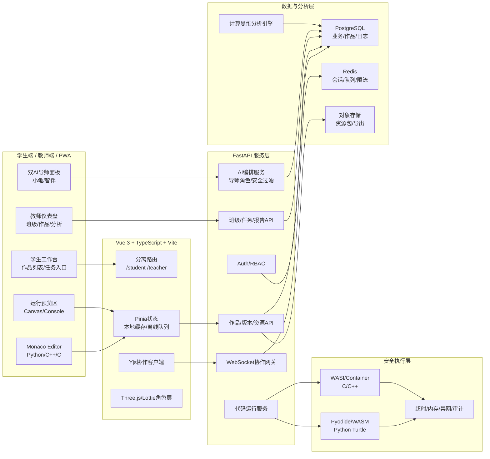

# 结对编程教育平台（CodeX / AI小海龟）全栈开发项目计划书与技术路线

版本：V1.0  
定位：面向初中信息科技课堂的 Web 优先、PWA/App-like 结对编程智能体平台  
主要依据：`6.13课题活页修改.docx`、本地 UI 参考图、公开海龟编辑器入口 `https://turtle.codemao.cn/home`、用户指定的技术与产品约束

## 1. 项目概述与目标（从课题摘录中提炼平台要达成的功能目标与教学价值）

### 1.1 项目定位

CodeX / AI小海龟是一套服务初中信息科技课堂的结对编程教育平台。平台以“人机协同结对编程”为核心教学组织方式，支持 Python、C++、C 三种语言模式，提供学生端编程环境、教师端教学研究仪表盘、双 AI 导师支架、实时/异步结对协作、过程性数据采集与计算思维评价。

平台不是单纯的在线 IDE，也不是让 AI 代替教师或学生写代码的工具，而是围绕课题提出的“结对编程智能体培养初中生计算思维”的研究目标，构建一个可部署、可观察、可迭代、可实证的教学环境。

### 1.2 从课题材料提炼的核心问题

课题材料指出，初中编程教学存在三类突出矛盾：

- 学生在抽象、分解、建模、算法设计、验证与优化、迁移等计算思维维度上发展不均衡。
- 传统“一人一机”课堂反馈滞后，教师面对 40-50 名学生时难以提供及时、个别化指导。
- 传统学生-学生结对质量不稳定，容易出现优生全写、弱生旁观、过程支架不足等问题。

因此，平台要解决的不是“能不能写代码”，而是“学生能否在写代码过程中被持续引导、被看见、被评价、被支持”。

### 1.3 平台目标

1. 构建支持计算思维培养的结对编程学习环境，覆盖问题分析、方案设计、编码实现、调试优化、迁移反思全过程。
2. 通过双 AI 导师提供即时支架，帮助学生在卡顿时降低认知负荷，在结对失衡时激活弱势参与者。
3. 建立学生端与教师端双闭环：学生获得即时反馈，教师获得过程性证据、课堂监控与研究数据。
4. 支持 Python 海龟绘图与 C/C++ 基础算法训练，兼顾视觉化创造与文本编程过渡。
5. 提供云端保存、本地下载/上传、版本历史、协作日志与 AI 互动日志，支撑教学研究和成果沉淀。

### 1.4 教学价值

- 对学生：形成“先分析、再设计、后编码、再验证”的编程习惯，提升计算思维的可迁移能力。
- 对教师：从事后批改转向过程指导，获得学生思维发展证据，支持精准教学与课题研究。
- 对学校：形成可复用的 AI 赋能信息科技课堂样板，沉淀教学案例、作品库、过程数据和研究报告。

## 2. 需求分析（功能性 + 非功能性：易用性、安全性、初中课堂性能、教师研究支持）

### 2.1 用户角色

| 角色 | 核心目标 | 主要需求 |
|---|---|---|
| 学生 | 完成编程任务、获得支架、保存作品 | 低门槛登录、作品列表、多语言编辑器、运行预览、AI 导师、下载上传、协作入口 |
| 教师 | 组织课堂、观察过程、评价作品 | 班级管理、任务布置、实时查看、日志分析、计算思维标签、报告导出 |
| 教研员/课题组 | 形成研究证据 | 数据脱敏、过程追踪、前后测关联、行为序列导出、案例库 |
| 管理员 | 安全合规与系统运维 | 账号管理、权限控制、审计日志、资源配额、异常告警 |

### 2.2 功能性需求

1. 多语言编程：Python 为主，支持海龟绘图；C++/C 支持基础算法、控制台输出与简单图形/可视化输出。
2. Monaco Editor：多语言语法高亮、自动补全、教育主题、错误定位、代码格式化、只读观察模式。
3. 运行预览：Python 海龟画布、控制台、图形输出区、运行状态与错误解释。
4. 云端作品：默认自动保存，支持版本历史、一键下载、本地上传继续编辑。
5. 双 AI 导师：小龟导师负责鼓励、任务拆解、Driver 支架；智伴导师负责审查、调试、Navigator/Reviewer 支架。
6. 结对协作：学生-学生实时协作，或学生-AI 配对；支持角色轮换、协作记录、教师旁观。
7. 教师端：班级、学生、任务、作品、AI 日志、协作过程、计算思维画像、导出报告。
8. 过程评价：围绕抽象、分解、建模、算法设计、验证优化、迁移六维建立标签与证据链。

### 2.3 非功能性需求

| 维度 | 要求 |
|---|---|
| 易用性 | 13-15 岁学生无需复杂配置即可开始；核心按钮可见；错误提示面向学习语言 |
| 安全性 | 代码沙箱隔离、超时/内存限制、禁网络/文件系统危险访问、AI 内容安全过滤 |
| 性能 | 适配学校低配置 Windows 电脑，首屏轻量，3D 角色可降级为 2D/Lottie |
| 稳定性 | 课堂网络波动下支持本地缓存、离线编辑、恢复同步 |
| 合规 | 未成年人数据最小化采集、监护授权、脱敏导出、审计留痕、结题销毁策略 |
| 研究支持 | 可导出过程日志、AI 对话摘要、代码演化、作品评价、计算思维标签 |

## 3. 平台整体架构设计（前后端分离、实时协作、AI集成、多语言执行、安全沙箱架构；附Mermaid架构图）

### 3.1 架构原则

- Web 优先：浏览器即入口，PWA 支持桌面快捷方式和移动端类 App 体验。
- 前后端分离：Vue 3 前端承载 IDE 和仪表盘，FastAPI 提供 API、WebSocket 和 AI 编排。
- 执行隔离：Python 优先本地 Pyodide/WASM，C/C++ 使用远端容器或 WASI 沙箱。
- 实时协作：WebSocket + CRDT/Yjs，同步编辑、光标、角色、事件日志。
- 教研可观测：所有学习关键事件进入过程数据管道，生成教师可读与研究可导出的双层数据。

### 3.2 Mermaid 架构图



### 3.3 多语言执行方案

- Python：浏览器端 Pyodide 运行基础 Python；海龟绘图通过 Canvas 适配层实现 `turtle` 子集；复杂依赖或长任务转入后端沙箱。
- C/C++：服务端编译运行，优先使用容器/WASI 隔离；只开放标准输入输出与受控图形 API；禁止任意文件、网络、进程操作。
- 统一输出：运行结果进入 `RunResult` 模型，包含 stdout、stderr、canvas commands、耗时、内存、错误定位。

## 4. 技术栈选择与详细理由（前端/后端/数据库/AI/部署/代码执行方案；必须说明为什么适合学校场景与你过往CodeAgent经验）

| 层级 | 技术 | 选择理由 |
|---|---|---|
| 前端框架 | Vue 3 + TypeScript + Vite | 学习曲线低、构建快、适合中大型教育产品组件化；Vite 适合快速迭代 |
| UI 框架 | Tailwind CSS + Element Plus | Tailwind 做高保真定制，Element Plus 做教师端表格、表单、弹窗和管理台 |
| 编辑器 | Monaco Editor | 多语言高亮、错误标记、Diff、只读模式、教育主题，接近真实开发体验 |
| 状态管理 | Pinia + VueUse | 轻量、类型友好，适合离线状态、缓存、用户偏好 |
| 实时协作 | WebSocket + Yjs | 成熟 CRDT，适合结对编辑、断线恢复、冲突合并 |
| 后端 | FastAPI + Pydantic | 类型清晰、OpenAPI 自动生成，适合 AI 编排、WebSocket、异步任务 |
| 数据库 | PostgreSQL | 结构化业务数据、JSONB 日志、统计查询能力强 |
| 缓存队列 | Redis | 会话、限流、协作房间、运行任务队列 |
| AI 编排 | Provider Adapter + Prompt Templates | 可切换模型供应商，便于学校私有化或云端部署 |
| Python 执行 | Pyodide/WASM + 后端沙箱兜底 | 前端低延迟、离线可用；复杂任务安全托管 |
| C/C++ 执行 | WASI/容器 Runner | 降低宿主风险，便于资源限制和审计 |
| 部署 | Docker Compose / Kubernetes 可选 | 学校小规模可单机部署，区域推广可容器编排 |

### 4.1 为什么适合学校场景

- 低配置适配：核心 IDE 不依赖重型 3D；AI 角色支持 LOD 和 2D 降级。
- 网络容错：作品本地 IndexedDB 缓存，网络恢复后同步。
- 安全可控：后端统一执行策略、AI 内容过滤、学生数据分级授权。
- 教师友好：教师端以仪表盘、表格、导出为主，不要求教师理解复杂技术概念。

### 4.2 CodeAgent 经验转化

以 CodeAgent 思路构建 AI 导师时，必须避免“答案直给”。平台采用四层约束：

1. 角色约束：Driver 倾向提问与鼓励，Navigator 倾向审查与测试建议。
2. 输出约束：默认给步骤、提示、测试思路；只有在教师允许或学生明确请求时给局部代码。
3. 数据约束：AI 建议必须绑定代码片段、错误、任务目标和计算思维标签。
4. 审计约束：保留 AI 建议、学生采纳/拒绝、修改结果，供教师复盘。

## 5. 详细功能模块拆解与用户旅程（学生端全流程、教师端全流程、AI服务模块、结对协作流程）

### 5.1 学生端全流程

1. 登录 `/student/login`：学生使用学校账号、班级码或教师发放账号登录。
2. 进入作品台：查看“继续学习、我的作品、教师任务、模板库、结对房间”瓷片。
3. 创建/打开作品：选择 Python 海龟、C++ 算法、C 基础、教师任务模板。
4. 编码与预览：Monaco 左侧/中部，右侧 Canvas/Console，底部运行日志。
5. AI 结对：右侧可折叠双导师面板，小龟提示任务拆解，智伴检查边界条件。
6. 保存与版本：默认云端自动保存，本地 IndexedDB 缓存；可下载 `.py/.cpp/.c + assets + metadata.json`。
7. 协作：邀请同伴或 AI 配对，系统记录 Driver/Navigator 角色、发言、代码事件。
8. 提交与反思：学生提交作品，填写自评，AI 生成“思路摘要”，教师可审阅。

### 5.2 教师端全流程

1. 登录 `/teacher/login`：教师端与学生端完全分离，权限、UI、数据范围不同。
2. 班级管理：创建班级、导入学生、分组、设置任务与时间。
3. 实时课堂：查看在线学生、运行状态、报错热力、协作房间、AI 求助频次。
4. 作品查看：按学生、任务、语言、计算思维标签筛选作品和版本。
5. AI 日志：查看 AI 提示类型、学生是否采纳、是否存在答案依赖风险。
6. 评价分析：按六维计算思维生成班级画像和个体成长档案。
7. 导出报告：导出班级报告、学生成长档案、研究数据 CSV/JSON、课题案例包。

### 5.3 AI 服务模块

| 模块 | 功能 |
|---|---|
| Tutor Router | 根据任务阶段、错误类型、学生水平选择小龟或智伴 |
| Prompt Guard | 注入教学规则、禁止直接代写、未成年人保护策略 |
| Code Context Builder | 提取当前文件、错误、运行结果、最近版本差异 |
| Suggestion Engine | 生成提示、测试建议、错误解释、局部修改建议 |
| CT Tagger | 将学生行为映射到抽象、分解、建模、算法、验证优化、迁移标签 |
| Teacher Summary | 将长对话压缩为教师可读摘要，不展示模型原始隐性推理 |

### 5.4 结对协作流程

1. 教师设置结对规则：随机、同质、异质、AI 配对、教师指定。
2. 学生进入房间：系统分配 Driver/Navigator，倒计时提醒轮换。
3. 协作编辑：Driver 编辑代码，Navigator 可评论、圈选、提建议。
4. AI 介入：当长时间无运行、连续报错、弱势学生沉默时，AI 以问题方式介入。
5. 教师旁观：教师可进入只读模式，发送提示或暂停协作。
6. 复盘：系统生成协作贡献、角色轮换、错误修复、思维标签报告。

## 6. UI/UX设计规范与高保真实现方案（颜色系统、字体、间距、组件规范；针对每张参考图片的还原建议 + 增强点；3D AI角色具体设计描述 + 技术实现路径 + 性能优化）

### 6.1 总体设计原则

- 学生端：活泼但不幼稚，教育蓝 `#4A90E2` 为主，温暖橙 `#F5A623` 为强调色，圆角卡片、柔和阴影、清晰图标。
- 教师端：专业、可信、数据密度更高，浅灰/蓝白为主，可视化层级明确。
- 登录页：借鉴“Pixel Rise”参考图的 3D 计算机、像素字体、橙色科技品牌，但改造成“AI小海龟”的教育科技入口。
- 瓷片区：借鉴本地 UI 瓷片参考图，使用模块化卡片承载模板、任务、继续学习、报告入口。

### 6.2 颜色系统

| Token | 色值 | 用途 |
|---|---|---|
| `--color-primary` | `#4A90E2` | 主按钮、学生端导航、链接 |
| `--color-accent` | `#F5A623` | 运行按钮、成就、AI 小龟高亮 |
| `--color-success` | `#2EC4B6` | 通过、保存成功、低风险提示 |
| `--color-warning` | `#FFB020` | 编译警告、等待同步 |
| `--color-danger` | `#E85D75` | 错误、违规、超时 |
| `--color-bg-student` | `#F7FAFF` | 学生端背景 |
| `--color-bg-teacher` | `#F4F7FB` | 教师端背景 |
| `--color-text` | `#1F2A44` | 主文本 |

### 6.3 字体与间距

- 字体：中文优先 `HarmonyOS Sans SC` / `Microsoft YaHei`，代码区 `JetBrains Mono` / `Cascadia Code`。
- 圆角：卡片 12-16px，按钮 8-12px，编辑器容器 10px。
- 间距：8px 基准网格；学生端宽松，教师端紧凑。
- 可访问性：按钮文本不低于 14px，主要操作对比度不低于 WCAG AA。

### 6.4 针对参考图的还原建议与增强点

| 参考图 | 可还原要素 | CodeX 增强方案 |
|---|---|---|
| `学生用户界面.png` | 顶部图标导航、柔和 pastel 卡片、学习进度、头像/角色中心区 | 改造为“作品进度、任务日历、AI 导师、最近运行错误、继续创作”学生工作台 |
| `登录界面.png` | 像素品牌、3D 橙色电脑、灰白空间、黑色登录按钮 | 品牌替换为 AI小海龟；3D 电脑屏幕展示海龟画布；右侧保留增长数字但改为“计算思维成长指数” |
| `UI瓷片区样式.jpg` | 小卡片模块、渐变底色、图标插画、状态徽标 | 用于模板库、任务库、作品类型、AI 支架入口、报告快捷入口 |
| `教师后端界面.jpg` | 浅色可视化大屏、数据卡片、漏斗/柱状/雷达图 | 用于班级画像、计算思维六维雷达、AI 互动分析、任务完成漏斗 |
| `教师后端界面2.jpg` | 教师形象、学生统计、班级分布、预警模块 | 设计为教师首页，中心为教师身份与课堂状态，左右为预警、作业、学生关怀 |

### 6.5 3D AI 角色设计

#### 小龟导师：Driver / 引导者

- 形象：蓝橙配色的小海龟，背壳有发光代码纹理，动作活泼。
- 性格：鼓励式、提问式、任务拆解式。
- 常见话术：先问“这道题的输入是什么？”“能不能把任务拆成三步？”
- UI 位置：学生 IDE 右侧可折叠 AI 面板顶部；运行错误时以小浮窗出现。

#### 智伴导师：Navigator / Reviewer

- 形象：沉稳的白蓝小机器人或书本精灵，佩戴小眼镜，手持检查清单。
- 性格：审查式、边界条件提示、测试用例建议。
- 常见话术：“你只测了样例，还需要考虑空输入或最大值。”“这段循环的终止条件是什么？”
- UI 位置：右侧面板的审查 Tab；提交前自动生成 Review Checklist。

### 6.6 技术实现路径与性能优化

1. 第一阶段使用高质量 2D PNG/Lottie 表情包，保证低配置电脑流畅。
2. 第二阶段引入 Three.js + 轻量 GLTF，模型面数控制在 5k-10k，纹理小于 1MB。
3. 使用 `prefers-reduced-motion`、帧率限制、懒加载、离屏暂停、LOD 降级。
4. 移动端和弱机默认 2D，桌面高性能设备开启 3D。
5. 角色动画只表达情绪与状态，不抢占 IDE 主注意力。

## 7. 数据库Schema与核心API设计（关键表结构 + 主要端点，含实时协作与AI日志）

### 7.1 核心表结构

```sql
users(id, role, username, display_name, password_hash, school_id, status, created_at)
students(user_id, grade, class_no, guardian_consent_at, learning_profile_json)
teachers(user_id, subject, title, department)
classes(id, name, grade, teacher_id, term, created_at)
class_members(id, class_id, student_id, joined_at)

projects(id, owner_id, title, language, visibility, latest_version_id, created_at, updated_at)
project_versions(id, project_id, version_no, code_snapshot, metadata_json, created_by, created_at)
project_assets(id, project_id, file_name, object_key, mime_type, size_bytes, created_at)

assignments(id, class_id, title, description, language, template_project_id, rubric_json, due_at)
submissions(id, assignment_id, student_id, project_version_id, status, submitted_at, teacher_feedback)

pair_sessions(id, mode, assignment_id, project_id, driver_id, navigator_id, ai_pair_enabled, started_at, ended_at)
collaboration_events(id, pair_session_id, user_id, event_type, payload_json, created_at)

code_runs(id, project_id, version_id, user_id, language, status, stdout, stderr, canvas_json, duration_ms, memory_kb, created_at)

ai_sessions(id, project_id, pair_session_id, student_id, tutor_role, started_at, ended_at)
ai_messages(id, ai_session_id, sender, message_type, content, safety_label, ct_tags_json, created_at)
ai_suggestions(id, ai_message_id, code_range_json, suggestion_type, accepted, evidence_json)

ct_observations(id, student_id, project_id, assignment_id, dimension, evidence_type, evidence_ref, score, created_at)
reports(id, scope_type, scope_id, report_type, object_key, generated_by, generated_at)
audit_logs(id, actor_id, action, resource_type, resource_id, ip, payload_json, created_at)
```

### 7.2 核心 API

| 模块 | Endpoint | 说明 |
|---|---|---|
| Auth | `POST /api/auth/student/login` | 学生登录 |
| Auth | `POST /api/auth/teacher/login` | 教师登录 |
| Project | `GET /api/student/projects` | 学生作品列表 |
| Project | `POST /api/student/projects` | 创建作品 |
| Project | `POST /api/projects/{id}/versions` | 保存版本 |
| Project | `GET /api/projects/{id}/download` | 下载本地包 |
| Project | `POST /api/projects/upload` | 上传本地包 |
| Run | `POST /api/run` | 提交运行任务 |
| AI | `POST /api/ai/tutor/message` | AI 导师对话 |
| AI | `POST /api/ai/review` | 提交前审查 |
| Collab | `WS /ws/collab/{session_id}` | 实时协作 |
| Teacher | `GET /api/teacher/classes/{id}/dashboard` | 班级仪表盘 |
| Teacher | `GET /api/teacher/students/{id}/portfolio` | 学生成长档案 |
| Teacher | `POST /api/teacher/assignments` | 布置任务 |
| Export | `POST /api/reports/export` | 导出报告 |

### 7.3 实时协作事件

```json
{
  "type": "code_patch | cursor | role_switch | run_result | ai_hint | teacher_note",
  "sessionId": "uuid",
  "actorId": "uuid",
  "timestamp": "2026-06-20T00:00:00Z",
  "payload": {}
}
```

## 8. 安全、合规与性能保障方案（代码沙箱、隐私、反作弊、初中电脑适配）

### 8.1 代码沙箱

| 风险 | 方案 |
|---|---|
| 死循环 | 单次运行 3-5 秒超时，教师可为比赛/进阶任务临时放宽 |
| 内存滥用 | 容器/WASM 内存上限，默认 128MB |
| 文件系统访问 | 只允许临时工作目录，运行后销毁 |
| 网络访问 | 学生代码默认禁网 |
| 系统调用 | C/C++ 使用 seccomp/WASI 白名单 |
| 恶意输出 | 输出长度限制，HTML 转义，禁止脚本注入 |

### 8.2 AI 安全

- 输入过滤：识别隐私、暴力、成人、诈骗、自伤等风险话题。
- 输出过滤：拒绝不适宜内容，避免直接给整题答案。
- 可解释反馈：提供“思路摘要、依据、下一步建议”，不展示模型原始隐性推理链。
- 教师可追溯：AI 建议、学生采纳、修改结果均可审计。

### 8.3 未成年人数据合规

1. 账号最小化：学生无需手机号，使用学校账号或匿名编号。
2. 授权机制：监护人授权、学生知情确认、可退出机制。
3. 数据分级：身份数据、学习数据、研究导出数据分层存储。
4. 脱敏导出：研究数据默认去除姓名、账号、IP 等直接标识。
5. 生命周期：课题结题后按约定销毁或归档。

### 8.4 初中电脑适配

- 首屏资源控制在 2-3MB 内，Monaco 按语言懒加载。
- Pyodide 延迟加载，仅在 Python 运行时加载。
- 3D 角色默认懒加载，可切换 2D。
- 低网速下先进入编辑器，AI 与同步稍后恢复。
- 支持 Chrome/Edge 主流版本，提供 PWA 桌面图标。

## 9. 开发路线图与里程碑（MVP Phase 1 / Phase 2 / Phase 3，明确每阶段可交付物与课题支撑点）

### Phase 1：MVP 原型与小范围试用（8-10 周）

可交付物：

- 学生端登录、作品列表、Python Monaco 编辑、海龟 Canvas 预览。
- 云端保存、版本历史、本地下载/上传。
- 基础 AI 小龟导师：任务拆解、错误解释、鼓励提示。
- 教师端基础班级与作品查看。
- 初版计算思维标签：分解、算法、调试三类。

课题支撑点：

- 支撑第 1 年行动研究 2-3 轮小范围试用。
- 验证学生是否能通过智能体提示完成问题分析与调试。

### Phase 2：稳定课堂版与准实验支持（12-16 周）

可交付物：

- C/C++ 安全运行服务。
- 双 AI 导师完整角色，小龟 + 智伴。
- 学生-学生实时协作，角色轮换与教师旁观。
- 教师仪表盘：在线状态、错误热力、AI 日志、作品版本。
- 六维计算思维评价模型与报告导出。

课题支撑点：

- 支撑第 2 年实验组/对照组准实验。
- 提供前后测、作品分析、过程行为日志的关联数据。

### Phase 3：推广版与研究成果沉淀（16-24 周）

可交付物：

- PWA 离线增强、移动端适配、区域多校部署。
- 任务模板库、教学活动模板、教师观察指南。
- 滞后序列分析导出、案例库、成长档案。
- 3D AI 角色与个性化成长系统。
- 管理员端与数据生命周期管理。

课题支撑点：

- 支撑第 3 年机制分析、追踪验证、成果推广。
- 形成教学模式、操作手册、案例集、论文数据包。

## 10. 风险识别与缓解措施 + 创新亮点（如何更好服务“研以致用”和论文实证）

### 10.1 风险识别与缓解

| 风险 | 影响 | 缓解 |
|---|---|---|
| AI 直接给答案 | 学生依赖，削弱思维培养 | 默认苏格拉底式提示；教师可设置答案级别；记录采纳行为 |
| 学校电脑性能不足 | 课堂卡顿 | 2D 默认、3D 可选、Pyodide 懒加载、服务端执行兜底 |
| C/C++ 沙箱复杂 | 安全风险 | MVP 先 Python，Phase 2 引入容器/WASI；严格禁网限时 |
| 协作冲突 | 学生体验差 | Yjs CRDT、角色权限、自动恢复 |
| 教师数据过载 | 看不懂、用不上 | 首页只显示预警、趋势、建议；详情按需展开 |
| 数据合规 | 未成年人隐私风险 | 最小采集、分库加密、脱敏导出、授权与销毁流程 |
| 研究证据不足 | 难以支撑论文 | 设计前后测关联、过程日志、作品量规、AI 互动编码 |

### 10.2 创新亮点

1. 从“人人结对”扩展到“人机结对”，稳定提供认知伙伴。
2. 从结果评价走向过程追踪，用代码演化、运行日志、AI 对话构建思维证据。
3. 双 AI 导师角色化：Driver 促进表达和行动，Navigator 促进审查和反思。
4. 支持 Python 海龟绘图到 C/C++ 文本编程的渐进过渡。
5. 教师端不是后台管理，而是教学研究工作台。
6. 将计算思维六维指标嵌入真实编程行为，而不是只靠问卷。

### 10.3 服务“研以致用”和论文实证

- 研：导出可编码的数据，包括 AI 消息、学生行为、运行错误、版本差异、协作事件。
- 用：教师可直接布置任务、观察学生、下载报告，避免研究平台与课堂工具脱节。
- 证：实验组/对照组差异可关联过程数据，支持解释“为什么有效”。
- 推：沉淀任务模板、操作手册、部署指南和教学案例，形成可推广成果包。

## 11. 补充功能建议（对齐课题目标的合理增强，如计算思维可视化标签、过程数据导出、IoT模拟模块接口等）

1. 计算思维雷达图：学生端展示自我成长，教师端展示班级分布。
2. 思维标签时间线：将“分解、建模、调试”等标签叠加到代码版本演化上。
3. AI 依赖风险指数：识别频繁复制建议、缺少自主运行的学生。
4. 项目任务库：海龟图案、数学图形、小游戏、算法挑战、跨学科项目。
5. IoT 模拟接口：为后续信息科技课程中的传感器、物联网主题预留模拟模块。
6. 教师提示词模板库：沉淀“如何问学生”“如何让 AI 降低支架强度”的策略。
7. 课堂大屏模式：展示匿名进度、错误热力、优秀思路，不暴露个人隐私。
8. 家校成长报告：只展示正向成长与建议，不暴露敏感对话。
9. 作品展厅：班级可发布优秀作品，支持二维码分享与离线展示。
10. 低代码任务编辑器：教师用表单配置任务目标、输入输出、评价量规和 AI 提示策略。

## 最终自审 Checklist

| 检查项 | 结果 | 说明 |
|---|---|---|
| 是否完整覆盖课题中对平台的功能要求与目标？ | 通过 | 已覆盖结对编程智能体、六维计算思维、教师监管、过程评价、安全伦理、研究成果 |
| UI风格是否高保真参考了海龟编辑器 + 图片暗示，同时适合初中生与教师区分？ | 通过 | 学生端柔和教育卡片，登录页 3D 像素科技，教师端专业数据仪表盘 |
| 3D AI角色设计是否可落地（性能+开发成本）且位置合理？ | 通过 | Phase 1 2D/Lottie，Phase 2 Three.js/GLTF，右侧面板与浮窗位置 |
| 技术方案是否安全、适合学校网络/电脑？ | 通过 | Pyodide 懒加载、C/C++ 沙箱、离线缓存、PWA、资源限制 |
| 路线图是否分阶段可执行？ | 通过 | Phase 1/2/3 分别对应原型、稳定实验、推广沉淀 |
| 是否体现“AI赋能+教师经验”而非替代？ | 通过 | AI 为支架和伙伴，教师端保留监管、评价、策略与报告 |
| 文档是否专业、结构清晰、可直接用于后续编码？ | 通过 | 已给出架构、技术栈、模块、Schema、API、安全、里程碑 |

## 后续可继续细化的交付物

- 前端路由与组件树设计：Vue 3 + TypeScript + Tailwind/Element Plus。
- Monaco Editor 多语言封装代码与教育主题 token。
- FastAPI 服务目录、SQLAlchemy/Alembic schema、WebSocket 协作协议。
- AI 双导师 Prompt 模板、输出 JSON Schema 与安全过滤策略。
- Pyodide Turtle Canvas 适配层与 C/C++ Runner 沙箱原型。
- Figma 高保真页面：学生工作台、IDE、登录页、教师首页、班级分析页。
- 3D 角色图片生成提示词与轻量 GLTF 制作规范。
