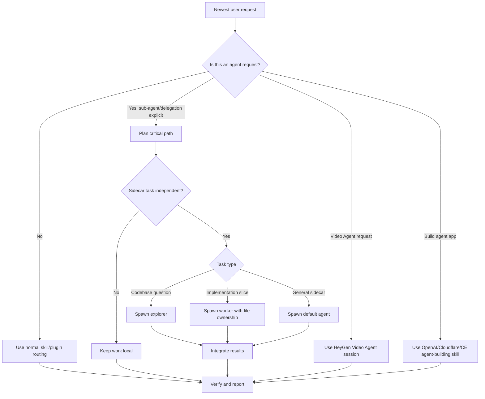

# Available Agents Logic

Generated: 2026-06-17
Workspace: `D:\VB\jiedui-code-platform\CX`

## 1. Scope

This document lists the agent-like capabilities currently available in this Codex environment.

Important distinction:

| Category | Meaning | Examples |
|---|---|---|
| Runtime agent | A callable agent/session capability that can actually be invoked from tools | `multi_agent_v1.spawn_agent`, HeyGen Video Agent |
| Supervisor layer | A monitoring/orchestration layer active in this thread, not a separate worker | `dev-supervisor` |
| Agent-development skill | A skill used to build, review, deploy, or test agents, but not itself a running agent | OpenAI Agents SDK, Cloudflare Agents SDK, Vercel Agent guidance |
| Browser/test automation | Agent-friendly automation utilities, not autonomous agents by themselves | `agent-browser`, Browser/Chrome plugin |

## 2. Runtime Agent Inventory

| Agent capability | Current status | Callable entry | Trigger | Core role |
|---|---|---|---|---|
| Codex main agent | Active | Current chat thread | Always active in this conversation | Primary planner, implementer, verifier, integrator |
| `dev-supervisor` | Active by user AGENTS.md rule | Local skill + supervisor scripts | Every development/setup/research round | Goal tracking, YOLO guardrails, timeline, quality gates, round report |
| Sub-agent: `default` | Available, not auto-started | `multi_agent_v1.spawn_agent` with `agent_type: "default"` or omitted | Only when user explicitly asks for sub-agents/delegation/parallel agent work | General bounded sidecar task |
| Sub-agent: `explorer` | Available, not auto-started | `multi_agent_v1.spawn_agent` with `agent_type: "explorer"` | Explicit delegation plus specific codebase question | Fast, focused codebase investigation |
| Sub-agent: `worker` | Available, not auto-started | `multi_agent_v1.spawn_agent` with `agent_type: "worker"` | Explicit delegation plus disjoint implementation scope | Bounded code changes, bug fixes, split refactors |
| HeyGen Video Agent | Available through HeyGen plugin tools | `mcp__codex_apps__heygen._video_agent_generate` and session tools | Specific video request with topic and narrative/script/style | Generates presenter-led videos and manages video agent sessions |

## 3. Sub-Agent Tool Logic

### `multi_agent_v1.spawn_agent`

Purpose: spawn a bounded sub-agent for a concrete task.

Available roles:

| Role | Best for | Avoid when |
|---|---|---|
| `default` | General sidecar work that does not need special behavior | The task is vague or blocks the immediate next step |
| `explorer` | Specific codebase questions, independent investigation, mapping a subsystem | Broad open-ended research or implementation |
| `worker` | Implementing a clearly owned slice of code, fixing a focused bug, editing a disjoint file set | Shared write scope, ambiguous ownership, urgent blocking work |

Callable schema:

| Field | Meaning |
|---|---|
| `agent_type` | Optional role: `default`, `explorer`, or `worker` |
| `fork_context` | Whether to fork current thread history into the new agent |
| `items` | Structured inputs: text, image, local image, skill, or mention |
| `message` | Plain task prompt |
| `model` | Optional model override; normally omitted |
| `reasoning_effort` | Optional reasoning override |
| `service_tier` | Optional service tier override |

Available model overrides:

| Model | Typical fit |
|---|---|
| `gpt-5.5` | Frontier work, difficult architecture/review/research |
| `gpt-5.4` | Everyday coding and implementation |
| `gpt-5.4-mini` | Small, fast, cost-efficient subtasks |
| `gpt-5.3-codex-spark` | Ultra-fast coding tasks |

Hard trigger rule:

- Use only when the user explicitly asks for sub-agents, delegation, parallel agent work, or similar wording.
- Requests for depth, detail, research, or thoroughness alone do not authorize spawning.

Execution logic:

1. Identify the main critical path.
2. Keep urgent blocking work local.
3. Delegate only independent sidecar tasks.
4. Give the sub-agent a narrow, self-contained prompt.
5. For coding workers, assign clear file/module ownership.
6. Continue local non-overlapping work while the sub-agent runs.
7. Integrate and review returned results.

Notes:

- The current exposed tool list shows `spawn_agent`; a separate `wait_agent` tool is referenced in guidance but is not currently exposed in the active tool list.
- Sub-agents are not persistent background daemons. They are spawned for bounded tasks.

## 4. Supervisor Agent Logic

### `dev-supervisor`

Type: always-on supervised development monitor for this workspace, activated by the user's AGENTS.md.

Current entry points:

| Script | Purpose |
|---|---|
| `C:\Users\nuoya\.codex\skills\dev-supervisor\scripts\supervisor-bootstrap.ps1` | Starts round, writes context snapshot, refreshes current goal, activates YOLO tracking |
| `C:\Users\nuoya\.codex\skills\dev-supervisor\scripts\supervisor-event.ps1` | Logs timeline events |

Runtime files:

| File | Purpose |
|---|---|
| `.codex-supervisor/context-snapshot.md` | Current workspace and context recovery snapshot |
| `.codex-supervisor/current-goal.md` | Current round goal and YOLO guardrails |
| `.codex-supervisor/timeline.jsonl` | Event timeline |
| `.codex-supervisor/status.md` | Human-readable status |
| `.codex-supervisor/dashboard.html` | Local dashboard if browser backend works |

Core behavior:

| Step | Logic |
|---|---|
| Bootstrap | Start every development/setup/research round with supervisor bootstrap |
| Goal mode | Set or refresh the current goal from the newest user request |
| YOLO execution | Proceed autonomously when intent is clear |
| Guardrails | No destructive filesystem/git actions, no secret/private state changes, no unsupported app config guesses |
| Review gate | After implementation and verification, run code-review-graph when possible |
| Final report | End development/setup rounds with a Round Execution Report |

Sub-agent policy under supervisor:

- Skills are not persistent agents by themselves.
- Sub-agents are only spawned when explicitly requested.
- Good sidecar tasks: independent review, verification, codebase exploration, UI/design audit.
- The main agent remains responsible for integration and final reporting.

## 5. HeyGen Video Agent Logic

Type: app/plugin video-generation agent session.

Primary trigger:

- User explicitly requests HeyGen or Video Agent.
- User provides a specific video topic plus narrative/script/style details.
- Examples: product demo, presenter video, personalized outreach, video pitch, team update.

Do not call directly when:

- The request is vague, such as "make me a video" without topic/details.
- The task is avatar creation only.
- The user wants video translation, TTS-only, b-roll-only, or non-presenter cinematic footage.

Callable tools currently exposed:

| Tool | Purpose |
|---|---|
| `_video_agent_generate` | Main Video Agent generation/session continuation |
| `_get_video_agent_session` | Get status, progress, video id, recent messages |
| `_list_video_agent_sessions` | List user's video agent sessions |
| `_stop_video_agent_session` | Stop active session at checkpoint |
| `_list_video_agent_session_videos` | List videos produced in a session |
| `_get_video_agent_resource` | Get session resource by id |
| `_list_video_agent_styles` | Browse curated style templates |
| `_create_avatar_consent` | Start consent flow for private avatar group |
| `_get_current_user` | Get user profile/credits |
| `_list_videos`, `_get_video`, `_delete_video` | Manage finished videos |
| `_list_video_translations`, `_update_video_translation`, `_delete_video_translation` | Manage video translation jobs |
| `_list_video_translation_languages` | List supported translation languages |
| `_list_lipsyncs`, `_update_lipsync`, `_delete_lipsync` | Manage lipsync jobs |

Session logic:

1. First call leaves `sessionId` empty to create a new session.
2. Follow-up calls reuse `sessionId`.
3. New unrelated video requests create a fresh session.
4. `conversationContext` must include actual referenced content, not vague "above" wording.
5. Result should be delivered as user-facing video link/summary, not raw API plumbing.

## 6. Agent-Orchestration Skills

These are installed skill documents for coordinating agent work. They do not override the current rule that sub-agents require explicit user authorization.

| Skill | Path | Core logic |
|---|---|---|
| `superpowers:dispatching-parallel-agents` | `C:\Users\nuoya\.codex\plugins\cache\openai-curated\superpowers\43313cc9\skills\dispatching-parallel-agents\SKILL.md` | Use one agent per independent problem domain, especially unrelated failures or test groups |
| `superpowers:subagent-driven-development` | `C:\Users\nuoya\.codex\plugins\cache\openai-curated\superpowers\43313cc9\skills\subagent-driven-development\SKILL.md` | Execute implementation plans with fresh subagent per task and two-stage review |
| `compound-engineering` | `C:\Users\nuoya\.codex\skills\compound-engineering\SKILL.md` | Umbrella workflow for strategy, planning, work, debugging, review, PR feedback, and durable learning |
| `ce-work-beta` | `C:\Users\nuoya\.codex\skills\ce-work-beta\SKILL.md` | Experimental external delegate support for execution |
| `lfg` | `C:\Users\nuoya\.codex\skills\lfg\SKILL.md` | Full autonomous engineering pipeline; use only when user explicitly asks for full autonomous execution |

Parallel-agent decision matrix:

| Situation | Agent decision |
|---|---|
| Same bug, same files, shared state | Keep local or use one agent |
| Multiple unrelated failing tests | Consider parallel explorers/workers if user asked for delegation |
| Independent subsystems with disjoint files | Consider worker agents with clear ownership |
| Need urgent answer before next step | Do locally |
| Need independent review while main work continues | Delegate reviewer if user authorized sub-agents |

## 7. Agent-Building Skills

These help create or evaluate agent applications. They are not live sub-agents.

| Skill | Source | Use when | Core role |
|---|---|---|---|
| `openai-developers:agents-sdk` | OpenAI Developers plugin | Building or adapting OpenAI Agents SDK apps | Create runnable agent prototype, add tools, evals, deployment workflow |
| `cloudflare:agents-sdk` | Cloudflare plugin | Building stateful agents on Cloudflare Workers | Agent class, persistent state, scheduling, workflows, MCP, React hooks |
| `cloudflare:building-ai-agent-on-cloudflare` | Cloudflare plugin | Production Cloudflare AI agent app | Workers deployment, tools, state, chat, WebSockets, scheduled tasks |
| `ce-agent-native-architecture` | Local CE skill | Designing apps where agents are first-class citizens | Agent-native architecture, MCP tools, self-modifying or outcome-driven systems |
| `ce-agent-native-audit` | Local CE skill | Reviewing agent-native architecture | Scored architecture review |

OpenAI Agents SDK default build logic:

1. Read current official OpenAI agents docs before implementation.
2. Prefer Python unless TypeScript is requested.
3. Start with one agent and static instructions.
4. Add tools deliberately with narrow side effects.
5. Use `SandboxAgent` only when file/shell/workspace isolation is required.
6. Add local smoke tests and eval harnesses when requested.
7. Use `OPENAI_API_KEY` only through the approved credential gate.

Cloudflare Agents SDK default build logic:

1. Retrieve current Cloudflare Agents SDK docs before implementation.
2. Verify `agents` package installation.
3. Configure Worker binding and Durable Object/SQLite migration.
4. Implement an `Agent<Env, State>` class.
5. Use `setState`, SQL, scheduling, workflows, or MCP only when needed.
6. Route requests through `routeAgentRequest`.
7. Use React hooks such as `useAgent` or `useAgentChat` for client integration.

## 8. Platform Agent/Automation Skills

| Skill/tool | Type | Use when | Core role |
|---|---|---|---|
| `vercel:vercel-agent` | Platform guidance | Vercel AI code review, incident investigation, SDK install | Explain/configure Vercel Agent capabilities |
| `vercel:agent-browser` | Browser automation CLI | Navigate/test/fill/click/screenshot/extract website data | Browser interaction for AI agents |
| `vercel:agent-browser-verify` | Browser verification | Dev server starts or visual smoke check needed | Page loads, console errors, key UI elements |
| `build-ios-apps:ios-debugger-agent` | iOS debugging skill | Launch iOS Simulator app, inspect UI/logs/runtime | Build/run/debug with XcodeBuildMCP |
| Browser plugin | Bundled plugin | Localhost/file/browser interaction in Codex app | In-app browser automation when backend works |
| Chrome plugin | Bundled plugin | Authenticated/profile-dependent browser work | Chrome automation |

## 9. Agent-Related Capabilities With Caveats

| Capability | Status | Caveat |
|---|---|---|
| `gstack` | Local directory exists | Health note says `SKILL.md` is unreadable/zero-byte reparse point. Do not route to it unless repaired |
| Browser plugin | Installed | Health note says backend may fail to start in this session. Prefer Browser when it works, otherwise use verified fallback |
| GitHub plugin | Installed | Some public blob/README fetching may be limited. Use local `git clone` or `gh` fallback when needed |
| `code-review-graph` | Available as Python module | Use `python -m code_review_graph`; bare command may not be on PATH |
| Current workspace git review | Not available | `D:\VB\jiedui-code-platform\CX` is not currently a git repository |

## 10. Routing Cheat Sheet

| User asks | Route |
|---|---|
| "Use sub-agents / parallel agents / delegate this" | `multi_agent_v1.spawn_agent` after deciding critical path |
| "Have one agent inspect this part of the code" | `explorer` role |
| "Have an agent implement this isolated module" | `worker` role with file ownership |
| "Make a HeyGen video..." | HeyGen Video Agent tools |
| "Build an OpenAI agent app" | `openai-developers:agents-sdk` |
| "Build a Cloudflare agent" | `cloudflare:agents-sdk` or `cloudflare:building-ai-agent-on-cloudflare` |
| "Design an agent-native architecture" | `ce-agent-native-architecture` |
| "Audit this agent architecture" | `ce-agent-native-audit` |
| "Use Vercel Agent" | `vercel:vercel-agent` |
| "Open/test/click this web app" | Browser plugin first; fallback to browser automation tooling if needed |

## 11. High-Level Flow

## 12. Practical Rules I Will Follow

- I will not spawn sub-agents unless you explicitly ask for them.
- I will not treat ordinary skills as persistent background agents.
- I will keep delegated work bounded, concrete, and non-overlapping.
- I will keep urgent blocking work in the main thread.
- I will integrate and verify any sub-agent result before reporting it as done.
- I will use `dev-supervisor` as the always-on monitoring layer unless you explicitly disable it.
