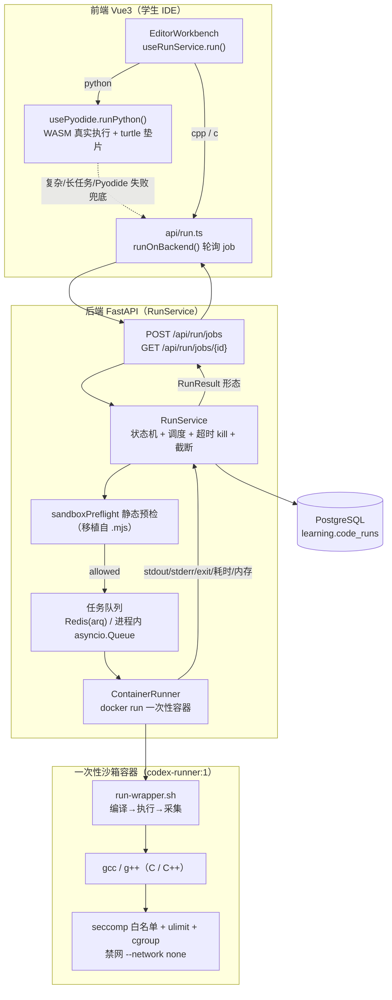
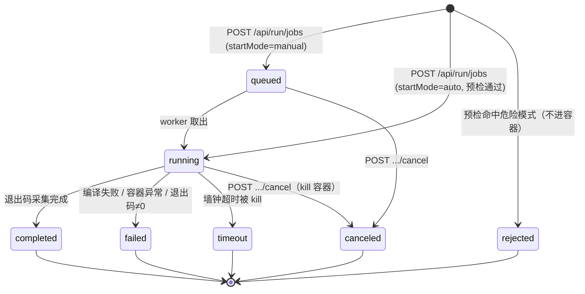

# IMPL · 三语言真实执行（Python / C++ / C）· 实现级设计

> 本文是《补充与优化升级_开发计划书与技术路线.md》**§4.2「三语言真实执行」的实现级展开**，工程师可直接照此开发。
>
> 配套阅读：
> - `specs/IMPL-双模编辑器-实现级设计.md`（**前端 `RunResult` 契约与 `mapJobToRunResult` 适配层的权威定义，本文不改动它**）
> - `specs/IMPL-数据安全合规-实现级设计.md`（分库/字段加密/审计约定，本文 `code_runs` 沿用其 `learning.` schema 与 PG 约定）
> - `specs/phase2h-sandbox-job-contract.md`、`specs/phase2i-runner-boundary-contract.md`、`specs/phase2q-sandbox-isolation-hardening-contract.md`（**job 生命周期与隔离证据契约，本文给出其服务端真实实现**）
>
> 版本：V1.0 ｜ 编写日期：2026-06-22 ｜ 适用阶段：S1（Python/Pyodide）→ S2（C/C++ 容器 Runner）

---

## 0. 问题陈述与本文边界

### 0.1 当前最大短板（必须替掉的"假运行"）

CX 当前的"运行"是纯模拟，落在 `scripts/sandbox-runner.mjs::simulateRun`：

```js
// scripts/sandbox-runner.mjs（现状，必须被替掉）
function simulateRun(language, code) {
  if (language === "python") {
    const prints = [...String(code).matchAll(/print\((["'`])(.+?)\1\)/g)].map((m) => m[2]);
    return { status: "completed", stdout: prints.length ? prints.join("\n") : "Canvas updated: turtle path generated", ... };
  }
  return { status: "completed", stdout: language === "cpp" ? "gcd(24, 18)=6" : "Computational thinking challenge: excellent", ... };
}
```

即：**Python 仅正则回显 `print` 字面量；C/C++ 返回写死固定串；无任一语言真实编译/运行。** 唯一为真的是 `sandbox-isolation.mjs::sandboxPreflight`（危险模式静态预检）。

本文给出"用真实执行替掉 `simulateRun`"的完整实现方案。

### 0.2 本文做什么 / 不做什么

| 做（本文范围） | 不做（其他文档/前端契约） |
|---|---|
| 定义 `POST /api/run/jobs` / `GET /api/run/jobs/{id}` 的**服务端真实实现**（job 状态机、调度、隔离、组装） | 不改动**前端 `RunResult` 契约**与 `mapJobToRunResult`（编辑器文档已定义，本文只负责"喂对字段"） |
| Python = Pyodide 浏览器内真实执行 + 后端兜底触发 | 不重写 turtle→Canvas 渲染（编辑器文档已定义协议与渲染器） |
| C/C++ = 后端容器 Runner（Docker + gcc/g++ + seccomp + ulimit + 禁网 + 超时 + 截断 + 临时目录销毁） | 不引入真实 LLM/支付/外部密钥 |
| Judge0 备选对比与推荐 | 不替换 `sandboxPreflight` 静态预检（与本文**正交互补**，二者都保留） |
| `code_runs` 数据模型（对接计算思维过程分析） | 不实现 CT 标注引擎本身（消费 `code_runs` 的下游） |

### 0.3 与既有"危险模式预检"的关系（正交互补，二者保留）

```
                         ┌────────────────────────────────────────┐
学生代码  ──►  ① 静态预检 sandboxPreflight  ──►  ② 真实执行隔离（本文）
              （regex 拦 os/socket/eval/      （容器 seccomp+ulimit+禁网+
               死循环；快、零成本、可解释）       超时；拦运行时真实越界）
```

- **① 静态预检**：在 job 进入运行前先跑 `sandboxPreflight(language, code)`，命中即 `rejected`，**不进容器**（省算力、给学生可解释提示）。
- **② 真实执行隔离**：通过预检的代码进入容器/Pyodide，由 seccomp/ulimit/超时拦运行时真实越界（静态预检绕不过的）。
- 两层是**纵深防御**，缺一不可：静态预检便宜但可被混淆绕过；真实隔离兜底但成本高。**本文不削弱预检，只在其后加真实隔离。**

---

## 1. 执行架构总览

### 1.1 两条执行路径 + 任务队列



### 1.2 分语言分层职责

| 语言 | 执行位置 | 引擎 | 隔离手段 | 典型延迟 | canvasCommands |
|---|---|---|---|---|---|
| **Python** | 浏览器内 | Pyodide（WASM 真实 CPython） | 浏览器进程沙箱 + turtle 垫片（无真实 FS/网络）+ 运行前静态预检 | 首次加载数 MB，之后 < 200ms | 由 turtle 垫片产出（核心价值） |
| **Python（兜底）** | 后端容器 | `python3 -I -X utf8 -B` | 容器 seccomp/ulimit/禁网 | 0.5–2s | 后端无 Canvas，通常空 |
| **C++** | 后端容器 | `g++ -std=c++17` | 容器 seccomp/ulimit/禁网/超时/截断 | 编译 1–3s + 运行 | 空（C/C++ 不画海龟） |
| **C** | 后端容器 | `gcc -std=c11` | 同上 | 同上 | 空 |

**为什么 Python 走浏览器：** 低延迟、离线、低配课堂友好、天然隔离（无真实 FS/Socket）、turtle 可视化是课题核心体验。**为什么 C/C++ 走后端：** 浏览器无 C/C++ 工具链，必须真实 `gcc/g++` 编译，必须强隔离。

### 1.3 后端兜底（Python 转后端）触发条件

`usePyodide.runPython()` 失败或不适用时，`useRunService` 自动改走 `runOnBackend('python', code)`（编辑器文档 §6.3 时序已定义）。触发条件：

1. **Pyodide 加载失败**（CDN 不可达 / WASM 不支持的旧设备）；
2. **运行超时**（浏览器内 watchdog 超过 8s，主线程将卡死，转后端用真正可 kill 的容器）；
3. **需要标准库 Python 才有的包**（如教师任务显式声明 `requires: ["numpy>1.20 非 Pyodide 移植版"]`，本期默认不开放）；
4. **教师强制后端**（任务配置 `runtime: "backend"`，用于统一评测口径）。

> 触发兜底时，前端把同一份 `code` 投到 `POST /api/run/jobs`，后端按 C/C++ 同套 job 流程跑 `python3`（无 turtle、canvasCommands 为空）。学生看到的是 stdout/stderr，绘图能力仅在浏览器 Pyodide 路径提供——这是可接受的产品取舍（绘图任务本就建议在线运行）。

---

## 2. Job 生命周期（服务端真实实现）

### 2.1 状态机



**Terminal 状态集合（与前端 `api/run.ts` 的 `TERMINAL` 完全一致）：**
`{ completed, failed, timeout, rejected, canceled }`。前端轮询遇到这五个之一即停止并 `mapJobToRunResult`。

> 取舍说明：编辑器文档的 `mapJobToRunResult` 只显式分支了 `timeout`/`rejected`，其余靠 `stderr` 落到 `parseStderr`。本文服务端**对 `failed` 也填充 `result.stderr` 与 `result.errorLocator`（snake/camel 双写）**，保证 `failed` 在前端也能正确高亮报错行，不需要改前端契约。

### 2.2 `POST /api/run/jobs`（创建并执行）

**请求体**（在 phase2i 基础上无破坏性扩展）：

```json
{
  "language": "cpp",
  "code": "#include <cstdio>\nint main(){printf(\"hi\\n\");}",
  "stdin": "3 4\n",
  "runnerTimeoutMs": 5000,
  "startMode": "auto",
  "taskId": "task-uuid-optional",
  "projectVersionId": "pv-uuid-optional"
}
```

字段约束：

| 字段 | 类型 | 默认 | 约束 |
|---|---|---|---|
| `language` | `"python"\|"cpp"\|"c"` | 必填 | 白名单外 → `400` |
| `code` | string | 必填 | 上限 **64 KB**（`MAX_SOURCE_BYTES`），超出 `413` |
| `stdin` | string | `""` | 上限 **16 KB** |
| `runnerTimeoutMs` | int | 3000 | 钳制到 `[1000, TEACHER_MAX_MS=15000]`；学生默认 3–5s，教师可放宽 |
| `startMode` | `"auto"\|"manual"` | `"auto"` | `manual` → 进 `queued`，供取消/调度测试 |
| `taskId`/`projectVersionId` | uuid | null | 写入 `code_runs` 供过程分析 |

**响应体**（`auto` 同步等到 terminal；本期容器执行 1–4s 在 HTTP 内可接受，长任务见 §8 异步化）：

```json
{
  "job": {
    "id": "job-7f3a...",
    "language": "cpp",
    "status": "completed",
    "progress": 100,
    "terminal": true,
    "lifecycle": [
      { "state": "queued",    "at": "2026-06-22T08:00:00.010Z" },
      { "state": "running",   "at": "2026-06-22T08:00:00.020Z" },
      { "state": "completed", "at": "2026-06-22T08:00:02.530Z" }
    ],
    "runner": {
      "engine": "container-runner-v1",
      "isolation": "docker-seccomp-ulimit-nonet",
      "image": "codex-runner:1",
      "timeoutMs": 5000,
      "timedOut": false,
      "exitCode": 0
    },
    "result": {
      "status": "completed",
      "stdout": "hi\n",
      "stderr": "",
      "exitCode": 0,
      "durationMs": 2510,
      "duration_ms": 2510,
      "memoryKb": 1840,
      "memory_kb": 1840,
      "canvas": [],
      "canvasCommands": [],
      "errorLocator": null,
      "outputTruncated": false,
      "runnerDiagnostics": {
        "engine": "container-runner-v1",
        "isolation": "docker-seccomp-ulimit-nonet",
        "isolationTier": "T3-container-hardened",
        "network": "disabled",
        "filesystem": "ephemeral-container-tmpfs",
        "envPolicy": "allowlist-scrubbed",
        "secretEnvPresent": false,
        "outputLimitBytes": 65536,
        "workspace": { "kind": "ephemeral-container", "created": true, "cleaned": true, "pathExposed": false }
      }
    }
  }
}
```

> **与 `mapJobToRunResult` 的精确衔接**：前端读取 `job.result` 里的 `stdout / stderr / canvas|canvasCommands / durationMs|duration_ms / memoryKb|memory_kb / errorLocator`。本文服务端**对耗时/内存同时输出 camelCase 与 snake_case**，使前端 `res.durationMs ?? res.duration_ms` 两路都命中；`canvas` 与 `canvasCommands` 也双写。这样既满足 job 契约的 snake 习惯，又零成本喂饱前端 camelCase 契约。

### 2.3 `GET /api/run/jobs/{id}`（轮询）

返回与创建响应**同形**的 `{ job }`。`manual`/异步模式下 `status` 可能仍是 `queued`/`running`，前端按 250ms 轮询直到 terminal。`progress` 取值：`queued=10 → running=60 → terminal=100`（仅用于进度条，无强语义）。

### 2.4 其他端点（保持 phase2h/2i 兼容）

| 端点 | 说明 |
|---|---|
| `GET /api/run/jobs` | 最近 N 条 job（教师/研究证据，去敏） |
| `POST /api/run/jobs/{id}/cancel` | 取消 `queued`/`running`；已 terminal → `409`；`running` 时 `docker kill` 容器 |
| `POST /api/run` | 兼容端点：内部建 job、同步等 terminal、返回 `{ stdout, jobId, jobStatus, terminal, lifecycle, runnerDiagnostics }` |
| `POST /api/reports/export` | 增 `completed/failed/timeout/rejected/canceled/runnerBoundaryCount` 计数 |

### 2.5 可选 WebSocket 推送（替代轮询）

复用既有 WebSocket 房间：job 状态变更时向 `run:{jobId}` 频道推 `{ jobId, status, progress }`。前端优先订阅 WS，**轮询作为兜底**（WS 断线即回落 250ms 轮询，前端逻辑不变）。本期 S1/S2 可先只上轮询，WS 留接口位。

---

## 3. C/C++ 容器 Runner 实现

### 3.1 沙箱镜像 `Dockerfile`（最小化、非 root、装 gcc/g++）

```dockerfile
# images/codex-runner/Dockerfile
# 一次性执行容器：每次 run 起一个、跑完即删。镜像只装工具链，不装任何网络/解释外服务。
FROM debian:bookworm-slim

# 1) 仅装编译工具链 + 必要 C 标准库；--no-install-recommends 砍体积
RUN apt-get update \
 && apt-get install -y --no-install-recommends \
      gcc g++ libc6-dev \
 && apt-get purge -y --auto-remove \
 && rm -rf /var/lib/apt/lists/* /usr/share/doc /usr/share/man

# 2) 非 root 运行账号（uid 固定，便于宿主侧 cgroup/审计）
RUN groupadd -g 4242 runner && useradd -u 4242 -g runner -M -s /usr/sbin/nologin runner

# 3) 放入受控的 run-wrapper（见 §3.3），只读、可执行
COPY run-wrapper.sh /usr/local/bin/run-wrapper.sh
RUN chmod 0555 /usr/local/bin/run-wrapper.sh

# 4) 工作目录为 tmpfs 挂载点（宿主 docker run 时 --tmpfs /work 注入）
WORKDIR /work
USER runner

# 容器默认入口即 wrapper；实际资源限制由宿主 docker run 参数施加（见 §3.4）
ENTRYPOINT ["/usr/local/bin/run-wrapper.sh"]
```

构建：`docker build -t codex-runner:1 images/codex-runner/`。镜像约 300–400MB，节点本地预拉一次。

### 3.2 seccomp 白名单 profile（JSON 片段）

默认拒绝、仅放行编译与运行所需 syscall，**显式封死** `socket`/`connect`/`ptrace`/`clone(网络/新 namespace)`/`mount` 等。

```json
{
  "defaultAction": "SCMP_ACT_ERRNO",
  "defaultErrnoRet": 1,
  "archMap": [
    { "architecture": "SCMP_ARCH_X86_64", "subArchitectures": ["SCMP_ARCH_X86", "SCMP_ARCH_X32"] }
  ],
  "syscalls": [
    {
      "comment": "进程/内存/文件 IO —— gcc 与学生程序的基本面",
      "names": [
        "read", "write", "open", "openat", "close", "stat", "fstat", "lstat",
        "lseek", "mmap", "mprotect", "munmap", "brk", "rt_sigaction",
        "rt_sigprocmask", "rt_sigreturn", "access", "faccessat", "pipe", "pipe2",
        "dup", "dup2", "dup3", "fcntl", "getdents64", "getcwd", "readlink",
        "readlinkat", "arch_prctl", "set_tid_address", "set_robust_list",
        "futex", "getrandom", "clock_gettime", "gettimeofday", "nanosleep",
        "getpid", "getppid", "getuid", "geteuid", "getgid", "getegid",
        "uname", "sysinfo", "prlimit64", "rseq", "newfstatat", "statx",
        "exit", "exit_group", "wait4", "execve", "vfork"
      ],
      "action": "SCMP_ACT_ALLOW"
    },
    {
      "comment": "gcc 编译需要 fork/clone（受控：仅本地进程，禁网络/新 namespace 标志）",
      "names": ["clone", "clone3", "fork"],
      "action": "SCMP_ACT_ALLOW"
    }
  ]
}
```

> 关键封堵：`socket`/`socketpair`/`connect`/`bind`/`sendto`/`recvfrom`/`ptrace`/`mount`/`umount2`/`setns`/`unshare`/`reboot`/`kexec_load` 等**未出现在白名单**，命中 `defaultAction=SCMP_ACT_ERRNO`，直接 `EPERM`。即便 `--network none` 之外再加一层 syscall 级禁网。
> `clone` 仍需放行（gcc 子进程），但 `--network none` + 无 `CAP_NET_*` 已使网络 namespace 不可用；如需更严，可改用 `SCMP_ACT_ALLOW` + `args` 过滤 `clone` 的 `CLONE_NEWNET` 标志位（seccomp 支持按参数过滤）。

文件落位：`images/codex-runner/seccomp-runner.json`，宿主 `docker run --security-opt seccomp=...` 注入。

### 3.3 run-wrapper 脚本（编译→执行→采集）

```bash
#!/usr/bin/env bash
# /usr/local/bin/run-wrapper.sh
# 容器内入口。约定：宿主把 stdin 注入为容器 stdin；环境变量 RUN_LANG 指定语言。
# 输出协议：把结构化结果作为单行 JSON 写到 fd=3（宿主用 --output 重定向到文件/管道）。
# stdout/stderr 分别捕获到文件再读回，避免与 JSON 协议串味。
set -u
LANG_ID="${RUN_LANG:?missing RUN_LANG}"     # c | cpp | python
WORK="/work"
SRC_OUT="$WORK/out"                          # 学生程序的 stdout
SRC_ERR="$WORK/err"                          # 学生程序的 stderr（运行期）
COMPILE_ERR="$WORK/cerr"                     # 编译期 stderr
BIN="$WORK/a.out"
OUTPUT_LIMIT=$((64 * 1024))                  # 与 OUTPUT_LIMIT_BYTES 对齐

# 1) 落源码（宿主已通过 stdin 把源码以 here-doc 之外的方式写好；此处约定源码已在 /work/main.<ext>）
case "$LANG_ID" in
  c)   SRC="$WORK/main.c";   COMPILE=(gcc  -std=c11   -O1 -w -o "$BIN" "$SRC") ;;
  cpp) SRC="$WORK/main.cpp"; COMPILE=(g++  -std=c++17 -O1 -w -o "$BIN" "$SRC") ;;
  python) SRC="$WORK/main.py"; COMPILE=() ;;            # Python 兜底：无编译步
  *) echo '{"phase":"reject","reason":"bad-lang"}' >&3; exit 64 ;;
esac

emit() { printf '%s\n' "$1" >&3; }
json_escape() { python3 - "$1" <<'PY' 2>/dev/null || sed -e 's/\\/\\\\/g;s/"/\\"/g' <<<"$1"
import json,sys; print(json.dumps(sys.argv[1]))
PY
}

# 2) 编译（C/C++）。编译墙钟也受宿主超时控制，这里只做软上限提示。
if [ "${#COMPILE[@]}" -gt 0 ]; then
  C_T0=$(date +%s%3N)
  if ! "${COMPILE[@]}" 2>"$COMPILE_ERR"; then
    C_T1=$(date +%s%3N)
    CERR_CONTENT=$(head -c "$OUTPUT_LIMIT" "$COMPILE_ERR")
    emit "{\"phase\":\"compile_error\",\"compileMs\":$((C_T1-C_T0)),\"stderr\":$(json_escape "$CERR_CONTENT")}"
    exit 1
  fi
fi

# 3) 执行学生程序。/usr/bin/time -v 拿峰值内存（maxrss KB）。
RUN_T0=$(date +%s%3N)
if [ "$LANG_ID" = "python" ]; then
  /usr/bin/time -v -o "$WORK/time" python3 -I -X utf8 -B "$SRC" >"$SRC_OUT" 2>"$SRC_ERR"
  RC=$?
else
  /usr/bin/time -v -o "$WORK/time" "$BIN" >"$SRC_OUT" 2>"$SRC_ERR"
  RC=$?
fi
RUN_T1=$(date +%s%3N)

# 4) 采集 + 截断（字节级，UTF-8 安全由前端展示层兜底）
STDOUT=$(head -c "$OUTPUT_LIMIT" "$SRC_OUT")
STDERR=$(head -c "$OUTPUT_LIMIT" "$SRC_ERR")
OUT_BYTES=$(wc -c <"$SRC_OUT")
TRUNC=false; [ "$OUT_BYTES" -gt "$OUTPUT_LIMIT" ] && TRUNC=true
MAXRSS=$(grep -oE 'Maximum resident set size.*: [0-9]+' "$WORK/time" | grep -oE '[0-9]+$')

emit "{\"phase\":\"run\",\"exitCode\":$RC,\"durationMs\":$((RUN_T1-RUN_T0)),\"memoryKb\":${MAXRSS:-0},\"outputTruncated\":$TRUNC,\"stdout\":$(json_escape "$STDOUT"),\"stderr\":$(json_escape "$STDERR")}"
exit 0
```

> 设计要点：
> - **源码不经命令行参数传入**（避免注入），由宿主在 `docker run` 前把 `main.<ext>` 写进容器的 `--tmpfs /work`（见 §3.4 用 `docker cp` 或 build-context 之外的临时 bind）。
> - **stdin 注入**：宿主 `docker run -i`，把学生 `stdin` 从宿主管道喂入；容器内 `python3`/`a.out` 直接继承 stdin。
> - **内存**用 `/usr/bin/time -v` 的 `Maximum resident set size`（KB），无须 cgroup 读取，简单可靠。
> - 结果走 **fd 3** 而非 stdout，与学生程序自身的 stdout 物理隔离，杜绝"学生 print 一段假 JSON 污染协议"。

### 3.4 宿主侧 `docker run` 资源限制（ulimit / cgroup / 禁网）

`RunService` 实际拼装的 docker 调用（关键参数全列）：

```python
DOCKER_ARGS = [
    "docker", "run", "--rm", "-i",
    "--name", container_name,                # 便于 cancel 时 docker kill
    "--network", "none",                     # 禁网（namespace 级）
    "--security-opt", "seccomp=/etc/codex/seccomp-runner.json",
    "--security-opt", "no-new-privileges",   # 禁提权
    "--cap-drop", "ALL",                     # 丢弃所有 capability
    "--read-only",                           # 根文件系统只读
    "--tmpfs", "/work:rw,noexec,nosuid,size=32m",  # 工作目录可写但 noexec 仅放数据；编译产物放 /tmp
    "--tmpfs", "/tmp:rw,exec,nosuid,size=32m",      # a.out 需可执行，单独给 /tmp
    "--pids-limit", "64",                    # 防 fork bomb（进程数硬上限）
    "--memory", "128m", "--memory-swap", "128m",   # 内存 128MB，禁用 swap 逃逸
    "--cpus", "1.0",                         # CPU 配额 1 核
    "--ulimit", "cpu=5:6",                   # CPU 时间软 5s 硬 6s（SIGXCPU 兜底死循环）
    "--ulimit", "fsize=10485760",            # 单文件 10MB（防写爆磁盘）
    "--ulimit", "nofile=64",                 # 文件描述符上限
    "--ulimit", "nproc=64",                  # 进程数上限（与 pids-limit 双保险）
    "--env", f"RUN_LANG={lang}",
    "codex-runner:1",
]
```

> 注意 `--read-only` + `--tmpfs`：根文件系统只读杜绝写 `/etc`/`/usr`；可写区只有受限大小的 `/work`(noexec) 与 `/tmp`(exec，放 `a.out`)。`--pids-limit 64` 与 `--ulimit nproc=64` 双重防 fork bomb。`--ulimit cpu=5:6` 给死循环一个 syscall 级硬停（即便墙钟 kill 失灵）。

### 3.5 FastAPI 侧 `RunService` 实现骨架

```python
# backend/app/services/run_service.py
from __future__ import annotations
import asyncio, json, os, shutil, tempfile, time, uuid
from dataclasses import dataclass, field
from datetime import datetime, timezone
from typing import Literal

from .sandbox_preflight import sandbox_preflight   # 移植自 sandbox-isolation.mjs（见 §3.6）
from .error_translate import translate_gcc_errors, parse_py_traceback  # 见 §3.7

OUTPUT_LIMIT_BYTES = 64 * 1024
MAX_SOURCE_BYTES   = 64 * 1024
TEACHER_MAX_MS     = 15_000
Lang = Literal["python", "cpp", "c"]
EXT  = {"python": "py", "cpp": "cpp", "c": "c"}

def _now() -> str:
    return datetime.now(timezone.utc).isoformat()

@dataclass
class Job:
    id: str
    language: Lang
    code: str
    stdin: str = ""
    timeout_ms: int = 3000
    status: str = "queued"
    progress: int = 10
    lifecycle: list = field(default_factory=list)
    result: dict | None = None
    runner: dict | None = None
    task_id: str | None = None
    project_version_id: str | None = None

    def transition(self, state: str, progress: int):
        self.status = state
        self.progress = progress
        self.lifecycle.append({"state": state, "at": _now()})


class RunService:
    def __init__(self, repo, queue):
        self.repo = repo            # 写 learning.code_runs（见 §7）
        self.queue = queue          # asyncio.Queue 或 arq（见 §8）

    async def create_job(self, *, language: Lang, code: str, stdin: str = "",
                         runner_timeout_ms: int | None = None, start_mode: str = "auto",
                         task_id=None, project_version_id=None, user_id=None) -> Job:
        if language not in EXT:
            raise ValueError("unsupported-language")            # → 400
        if len(code.encode("utf-8")) > MAX_SOURCE_BYTES:
            raise ValueError("source-too-large")                 # → 413
        timeout_ms = max(1000, min(int(runner_timeout_ms or 3000), TEACHER_MAX_MS))

        job = Job(id=f"job-{uuid.uuid4().hex[:12]}", language=language, code=code,
                  stdin=stdin[:16 * 1024], timeout_ms=timeout_ms,
                  task_id=task_id, project_version_id=project_version_id)
        job.transition("queued", 10)

        # ① 静态预检（正交互补，不进容器即拦危险模式）
        pre = sandbox_preflight(language, code)
        if not pre["allowed"]:
            job.runner = self._runner_meta(job, timed_out=False, exit_code=None)
            job.result = self._reject_result(pre)
            job.transition("rejected", 100)
            await self._persist(job, user_id)
            return job

        if start_mode == "manual":
            await self.queue.put(job.id)        # 留待 worker；保持 queued 非终态
            await self.repo.save_job(job)
            return job

        await self._execute(job)                # auto：同步执行到 terminal
        await self._persist(job, user_id)
        return job

    async def _execute(self, job: Job) -> None:
        job.transition("running", 60)
        if job.language == "python":            # Python 后端兜底路径（无 turtle）
            outcome = await self._run_container(job, "python")
        else:
            outcome = await self._run_container(job, job.language)
        self._assemble_result(job, outcome)

    async def _run_container(self, job: Job, lang: str) -> dict:
        workdir = tempfile.mkdtemp(prefix="codex-run-")        # 宿主临时目录
        container = f"codex-{job.id}"
        try:
            src_path = os.path.join(workdir, f"main.{EXT[lang]}")
            with open(src_path, "w", encoding="utf-8") as f:
                f.write(job.code)
            args = self._docker_args(container, lang, workdir)
            t0 = time.monotonic()
            proc = await asyncio.create_subprocess_exec(
                *args, stdin=asyncio.subprocess.PIPE,
                stdout=asyncio.subprocess.PIPE, stderr=asyncio.subprocess.PIPE,
            )
            try:
                # 墙钟超时 = 配置 + 编译缓冲 2s；超时则 docker kill
                wall = job.timeout_ms / 1000 + 2.0
                stdout, stderr = await asyncio.wait_for(
                    proc.communicate(input=job.stdin.encode("utf-8")), timeout=wall)
            except asyncio.TimeoutError:
                await self._kill(container)
                return {"phase": "timeout", "durationMs": int((time.monotonic() - t0) * 1000)}
            return self._parse_wrapper_output(stdout, stderr, int((time.monotonic() - t0) * 1000))
        finally:
            shutil.rmtree(workdir, ignore_errors=True)         # 临时工作目录销毁（必做）
            await self._kill(container, quiet=True)             # 双保险：确保容器不残留

    def _docker_args(self, name: str, lang: str, workdir: str) -> list[str]:
        # workdir 通过 bind 注入容器 /work（只挂源码目录，只读 + 单独 tmpfs 编译区）
        return [
            "docker", "run", "--rm", "-i", "--name", name,
            "--network", "none",
            "--security-opt", "seccomp=/etc/codex/seccomp-runner.json",
            "--security-opt", "no-new-privileges",
            "--cap-drop", "ALL", "--read-only",
            "-v", f"{workdir}:/work:ro",
            "--tmpfs", "/tmp:rw,exec,nosuid,size=32m",
            "--pids-limit", "64",
            "--memory", "128m", "--memory-swap", "128m", "--cpus", "1.0",
            "--ulimit", "cpu=5:6", "--ulimit", "fsize=10485760",
            "--ulimit", "nofile=64", "--ulimit", "nproc=64",
            "--env", f"RUN_LANG={lang}",
            "codex-runner:1",
        ]

    async def _kill(self, name: str, quiet: bool = False) -> None:
        p = await asyncio.create_subprocess_exec(
            "docker", "kill", name,
            stdout=asyncio.subprocess.DEVNULL, stderr=asyncio.subprocess.DEVNULL)
        await p.wait()

    def _parse_wrapper_output(self, stdout: bytes, stderr: bytes, wall_ms: int) -> dict:
        # wrapper 把结构化 JSON 写到 fd3；docker 把 fd3 并入 stdout 行。取最后一行 JSON。
        line = next((l for l in reversed(stdout.splitlines()) if l.strip().startswith(b"{")), b"{}")
        try:
            data = json.loads(line)
        except Exception:
            data = {"phase": "error", "stderr": stderr.decode("utf-8", "replace")[:OUTPUT_LIMIT_BYTES]}
        data.setdefault("wallMs", wall_ms)
        return data

    def _assemble_result(self, job: Job, o: dict) -> None:
        phase = o.get("phase")
        if phase == "timeout":
            job.runner = self._runner_meta(job, timed_out=True, exit_code=None)
            job.result = self._wrap_result(status="timeout", stdout="", stderr="",
                duration_ms=o.get("durationMs", 0), memory_kb=0,
                error_locator={"line": 1, "message": "运行超时，请检查是否有死循环（默认 5 秒上限）"})
            job.transition("timeout", 100); return

        if phase == "compile_error":
            loc, friendly = translate_gcc_errors(job.language, o.get("stderr", ""))
            job.runner = self._runner_meta(job, timed_out=False, exit_code=1)
            job.result = self._wrap_result(status="failed", stdout="", stderr=friendly,
                duration_ms=o.get("compileMs", 0), memory_kb=0, error_locator=loc)
            job.transition("failed", 100); return

        # phase == "run"
        rc = int(o.get("exitCode", 0))
        stderr = o.get("stderr", "")
        loc = None
        if rc != 0 and stderr:
            loc = (parse_py_traceback(stderr) if job.language == "python"
                   else translate_gcc_errors(job.language, stderr)[0])
        status = "completed" if rc == 0 else "failed"
        job.runner = self._runner_meta(job, timed_out=False, exit_code=rc)
        job.result = self._wrap_result(status=status, stdout=o.get("stdout", ""), stderr=stderr,
            duration_ms=o.get("durationMs", 0), memory_kb=int(o.get("memoryKb", 0) or 0),
            error_locator=loc, output_truncated=bool(o.get("outputTruncated")))
        job.transition(status, 100)

    # ---- 组装小工具（双写 camel/snake，喂饱前端 mapJobToRunResult）----
    def _wrap_result(self, *, status, stdout, stderr, duration_ms, memory_kb,
                     error_locator=None, output_truncated=False) -> dict:
        return {
            "status": status,
            "stdout": stdout, "stderr": stderr,
            "exitCode": None,
            "durationMs": duration_ms, "duration_ms": duration_ms,
            "memoryKb": memory_kb, "memory_kb": memory_kb,
            "canvas": [], "canvasCommands": [],          # C/C++ 恒空；Python 兜底也空
            "errorLocator": error_locator,
            "outputTruncated": output_truncated,
            "runnerDiagnostics": self._diag(),
        }

    def _reject_result(self, pre: dict) -> dict:
        msg = "\n".join(v["message"] for v in pre["violations"])
        return self._wrap_result(status="rejected", stdout="", stderr=msg,
            duration_ms=0, memory_kb=0,
            error_locator={"line": 1, "message": "代码被安全策略拦截：" + (pre["violations"][0]["message"] if pre["violations"] else "")})

    def _diag(self) -> dict:
        return {
            "engine": "container-runner-v1",
            "isolation": "docker-seccomp-ulimit-nonet",
            "isolationTier": "T3-container-hardened",
            "network": "disabled",
            "filesystem": "ephemeral-container-tmpfs",
            "envPolicy": "allowlist-scrubbed",
            "secretEnvPresent": False,
            "outputLimitBytes": OUTPUT_LIMIT_BYTES,
            "workspace": {"kind": "ephemeral-container", "created": True, "cleaned": True, "pathExposed": False},
        }

    def _runner_meta(self, job: Job, *, timed_out: bool, exit_code) -> dict:
        return {
            "engine": "container-runner-v1",
            "isolation": "docker-seccomp-ulimit-nonet",
            "image": "codex-runner:1",
            "timeoutMs": job.timeout_ms,
            "timedOut": timed_out,
            "exitCode": exit_code,
        }

    async def _persist(self, job: Job, user_id) -> None:
        await self.repo.save_code_run(job, user_id)   # 写 learning.code_runs（§7）
```

> **可移植与加固点（对照 CodeAgent 既有执行器）**：
> | CodeAgent 既有（直接移植） | 本文加固 |
> |---|---|
> | `subprocess` + 超时 | 改 `asyncio.create_subprocess_exec` + `asyncio.wait_for`，超时 **docker kill 容器**而非仅 kill 进程 |
> | 输出上限（字节截断） | wrapper 内 `head -c 64KB` + 服务端再校验，双层截断 |
> | Python 隔离模式 `-I -X utf8 -B` | **原样保留**用于 Python 后端兜底 |
> | POSIX `setrlimit`（CPU/内存/文件） | 升级为 **容器 `--ulimit` + cgroup（`--memory`/`--pids-limit`/`--cpus`）**，比单进程 setrlimit 更强（防 fork bomb、防 swap 逃逸） |
> | 临时文件销毁 | `finally: shutil.rmtree(workdir)` + `docker run --rm` + `docker kill` 三重确保无残留 |
> | g++ 编译运行 | 移入**只读根 + 禁网 + seccomp** 容器，加 `--cap-drop ALL --no-new-privileges` |

### 3.6 静态预检移植（`sandbox_preflight` Python 版）

把 `sandbox-isolation.mjs::sandboxPreflight` 的规则表 1:1 移植为 Python（正则与消息保持一致，保证师生看到的提示口径不变）：

```python
# backend/app/services/sandbox_preflight.py
import re
RULES = [
    ("python-os",         r"\bimport\s+os\b|\bfrom\s+os\s+import\b|\bos\.(environ|listdir|system|getcwd)", {"python"}, "Python os 模块与环境访问在学生沙箱中被禁用。"),
    ("python-subprocess", r"\bsubprocess\b|\bsocket\b|\bshutil\b|\bpathlib\b",                              {"python"}, "进程、套接字、文件系统模块被禁用。"),
    ("python-network",    r"\brequests\b|\burllib\b|\bhttp\.client\b|\bftplib\b|\bwebsocket\b",            {"python"}, "网络库在学生沙箱中被禁用。"),
    ("python-eval",       r"\beval\s*\(|\bexec\s*\(|\bopen\s*\(|\binput\s*\(|__import__\s*\(",             {"python"}, "eval、exec、动态导入、input、直接文件访问被禁用。"),
    ("path-traversal",    r"\.\.[/\\]|[A-Za-z]:\\|/etc/|/proc/|~[/\\]",                          {"python", "c", "cpp"}, "路径穿越与主机文件系统路径被禁用。"),
    ("c-system",          r"\bsystem\s*\(|\bfork\s*\(|\bexec[a-z]*\s*\(|#include\s*<\s*(fstream|filesystem|unistd\.h|sys/socket\.h|windows\.h)\s*>", {"c", "cpp"}, "原生 system、进程、文件、套接字调用被禁用。"),
    ("runaway-loop",      r"while\s*\(?\s*(true|1)\s*\)?\s*:|while\s*\(\s*(true|1)\s*\)|for\s*\(\s*;\s*;\s*\)", {"python", "c", "cpp"}, "无限循环需教师批准后才能运行。"),
]
def sandbox_preflight(language: str, code: str) -> dict:
    src = code or ""
    violations = [{"id": rid, "message": msg}
                  for (rid, pat, langs, msg) in RULES
                  if language in langs and re.search(pat, src, re.IGNORECASE)]
    return {"allowed": not violations,
            "safetyLabel": "sandbox-ok" if not violations else "sandbox-blocked",
            "violations": violations}
```

> 注意 `runaway-loop` 预检会把 `while True:` 直接判 `rejected`——这覆盖了"死循环超时"红队用例的**第一道**。但故意绕过该正则的死循环（如 `while 1==1:` 变体、递归爆栈）仍由容器 `--ulimit cpu` + 墙钟超时兜住，进入 `timeout` 状态。**两条路径都要在验收里验。**

### 3.7 编译错误定位与初中生友好翻译

把 g++/gcc 的 `file:line:col: error: msg` 解析出**第一处** error 的行列，并映射为浅显中文：

```python
# backend/app/services/error_translate.py
import re
from typing import Tuple

# gcc/g++:  main.cpp:5:10: error: 'cout' was not declared in this scope
GCC_LINE = re.compile(r"^[^:\n]+:(\d+):(\d+):\s*(error|fatal error):\s*(.+)$", re.MULTILINE)

# 面向初中生的"原文片段 → 浅显提示"映射（命中即替换，未命中保留原文并附通用提示）
FRIENDLY = [
    (re.compile(r"was not declared in this scope"),                 "用到了一个还没定义的名字（可能拼写错了，或忘了写 #include / 定义变量）。"),
    (re.compile(r"expected ';'"),                                   "这一行末尾少了一个分号 ;"),
    (re.compile(r"expected '\}'|expected '\)'|expected '\{'"),      "括号没有配对，检查 { } 或 ( ) 是否成对。"),
    (re.compile(r"'(.+?)' has no member named"),                    "这个对象没有你写的那个属性/方法，检查名字是否打错。"),
    (re.compile(r"no matching function for call"),                  "函数的参数个数或类型对不上，检查调用方式。"),
    (re.compile(r"redefinition of"),                                "同一个名字定义了两次，删掉重复的那一个。"),
    (re.compile(r"undefined reference to `main'"),                  "程序里没有 main 函数，C/C++ 必须有 int main()。"),
    (re.compile(r"control reaches end of non-void function"),       "声明了有返回值的函数，但有的分支忘了 return。"),
    (re.compile(r"#include .* No such file"),                       "#include 的头文件名写错了，检查尖括号里的拼写。"),
]

def translate_gcc_errors(language: str, stderr: str) -> Tuple[dict | None, str]:
    """返回 (errorLocator, 友好后的整段提示)。"""
    m = GCC_LINE.search(stderr or "")
    locator = None
    if m:
        line, col, _kind, msg = int(m.group(1)), int(m.group(2)), m.group(3), m.group(4)
        friendly = _friendly(msg)
        locator = {"line": line, "column": col, "message": friendly}
    # 整段：保留首条编译错误的友好提示 + 折叠原始信息供高年级查看
    head = locator["message"] if locator else "编译没通过，请看下面的错误信息。"
    return locator, f"❌ 第 {locator['line']} 行附近：{head}\n\n原始编译信息：\n{(stderr or '').strip()[:4000]}" if locator else (stderr or "")

def _friendly(msg: str) -> str:
    for pat, zh in FRIENDLY:
        if pat.search(msg):
            return zh
    return f"编译器提示：{msg}"

def parse_py_traceback(stderr: str) -> dict | None:
    """Python 后端兜底用：与前端 parsePyTraceback 同口径，取最后一个 line N。"""
    matches = re.findall(r"line (\d+)", stderr or "")
    if not matches:
        return None
    last = (stderr or "").strip().split("\n")[-1]
    return {"line": int(matches[-1]), "message": last or "运行出错"}
```

> 错误定位最终落到 `result.errorLocator{line, column?, message}`，由前端 `CodePanel.setErrorMarkers([r.errorLocator])` 在出错行打红色 marker（编辑器文档 AC-9）。**行号是相对于学生源码 `main.<ext>` 的，与编辑器行号一一对应**（容器内源码即学生原文，无包裹偏移）。

---

## 4. Judge0 备选方案对比与推荐

### 4.1 自建容器 Runner vs Judge0

| 维度 | 自建容器 Runner（§3） | Judge0（自托管开源版） |
|---|---|---|
| **架构** | FastAPI 直接 `docker run` 一次性容器 + 自写 wrapper | 独立服务：API + worker + PG + Redis + 隔离用 `isolate`（cgroup/namespace） |
| **多语言** | 仅需 C/C++/Python，按需扩 | 内置 60+ 语言（远超本课题所需，存在攻击面冗余） |
| **隔离机制** | docker + seccomp 白名单 + `--cap-drop ALL` + 只读根 + 禁网 | 基于 `isolate`（IOI 评测同款，cgroup v2 + namespace），隔离成熟 |
| **部署复杂度** | 低：一镜像 + 宿主装 docker | 中高：需起 server/worker/db/redis 全套，且 worker 需 `--privileged` 或特定内核能力 |
| **可控性/可审计** | **高**：wrapper、seccomp、限额、错误翻译全在我方代码，便于过课题安全审计与定制中文提示 | 中：定制错误中文翻译/CT 字段需在其外层包一层适配 |
| **资源限额** | 直接 docker 参数，逐 job 可调（教师放宽超时） | 通过 API 的 `cpu_time_limit`/`memory_limit` 等，粒度足够 |
| **工期** | C/C++ 路径约 **1.5–2 周**（镜像 + wrapper + RunService + 翻译 + 红队验收） | 部署 0.5 周，但**适配 job 契约 + 中文翻译 + 字段映射**仍需 1 周；总 ~1.5 周 |
| **离线/低配学校** | 单机一镜像即可，契合低配单机部署 | 组件多，单机内存压力大（PG+Redis+worker） |
| **安全责任面** | 我方完全掌握（也意味着我方需写对 seccomp） | 上游维护隔离层，但需跟进其 CVE，且 `--privileged` worker 是风险点 |

### 4.2 推荐与适用边界

**推荐：第一期自建容器 Runner（§3），不引入 Judge0。**

理由：
1. **语言面窄**——只需 Python(已走浏览器)/C/C++，Judge0 的 60+ 语言是负资产（更大攻击面、无谓维护）。
2. **可控性是课题刚需**——本课题要过"未成年人数据安全审计"，自建方案的 seccomp/限额/中文错误翻译/CT 字段全在我方代码内，审计与定制成本最低。
3. **低配单机部署友好**——Judge0 的 PG+Redis+worker 三件套在低配学校单机吃内存，自建一镜像更轻。
4. **可复用资产对齐**——CodeAgent 的 `subprocess`+rlimit+超时+g++ 执行器可直接移植加固成本最低。

**适用边界（何时改用 Judge0）：**
- 若**区域多校大规模**部署、需要**评测题库自动判题**（标准输入输出对拍、用时/内存排行榜）、且要支持**远超 3 语言**的竞赛语言 → Judge0 的成熟评测特性更划算。
- 若团队**没有把握写对 seccomp/cgroup**、又有专人运维 Judge0 集群 → 用 Judge0 把隔离责任外包给成熟项目。

> 折中落地：`RunService` 的 `_run_container` 抽象为 `RunnerBackend` 接口（`run(job) -> outcome`），自建容器是 `DockerRunnerBackend`；未来如需 Judge0，新增 `Judge0RunnerBackend` 即可切换，**job 契约与 RunResult 组装层不变**。

---

## 5. Python(Pyodide) 运行服务对接

> turtle 子集协议（`CanvasCommand`）、`turtle.shim.py` 垫片、`renderTurtle` 渲染器均由 `IMPL-双模编辑器-实现级设计.md §5` 定义。**本文聚焦"运行服务如何产出 `RunResult` 并回传 `canvasCommands`"以及兜底触发。**

### 5.1 Pyodide 加载与按需

- **懒加载**：仅首次运行 Python 时 `import('pyodide')` 拉 WASM（编辑器文档 `loadPyodide()`），加载进度反馈到终端"正在准备 Python 运行环境…"。
- **包按需**：本期 turtle 由**纯 Python 垫片**伪造（覆盖 `sys.modules['turtle']`），**不需 `loadPackage`**；若未来任务需 `numpy` 等，再 `await py.loadPackage('numpy')` 按需装（教师任务声明驱动）。
- **运行前静态预检**：浏览器侧也先跑一份与后端同口径的 `sandboxPreflight`（可由后端 `POST /api/run/preflight` 复用，或前端内置同规则），命中即不进 Pyodide，直接产出 `rejected` 态的 `RunResult`（`errorLocator` 给可解释提示）。这与后端预检口径一致。

### 5.2 运行服务如何产出 RunResult 并回传 canvasCommands

`usePyodide.runPython()`（编辑器文档已实现）产出的就是前端 `RunResult`：

```ts
// 关键：turtle 垫片把每个 turtle 调用记进 sys.modules['turtle']._commands，
// 运行结束后 json.dumps 取走 → 即 canvasCommands（CanvasCommand[]）
return {
  stdout, stderr,
  canvasCommands,           // ← turtle 子集协议，TurtleCanvas 回放
  durationMs,
  memoryKb: 0,              // 浏览器内不精确统计，按契约填 0
  errorLocator: stderr ? parsePyTraceback(stderr) : null,
}
```

- **canvasCommands 来源**：turtle 垫片记录 `forward/left/circle/...` → `CanvasCommand[]`；`TurtleCanvas.vue` 在 `canvasCommands.length>0` 时回放。**C/C++ 永远空数组**。
- **memoryKb=0**：浏览器内无法精确取峰值内存，按契约填 0（前端展示层对 0 显示"—"）。后端容器路径才有真实 `memoryKb`（`/usr/bin/time -v` 的 maxrss）。
- **errorLocator**：从 Python traceback 取最后一个 `line N`，与后端 `parse_py_traceback` 同口径。

### 5.3 兜底触发（前端→后端）

```ts
// useRunService.run() 内（编辑器文档 §6.3 已有时序，本文明确兜底判据）
if (language === 'python') {
  try {
    const r = await withWatchdog(() => runPython(code, stdinLines), 8000)  // 8s 主线程看门狗
    if (r) return r
  } catch (e) {
    // Pyodide 加载失败 / 看门狗超时 → 转后端容器（真正可 kill）
  }
  return runOnBackend('python', code)        // 后端 job：无 turtle，canvasCommands 为空
}
```

兜底触发条件（与 §1.3 一致）：Pyodide 加载失败、浏览器内 8s 看门狗超时、教师任务 `runtime:"backend"`、需非 Pyodide 包。

---

## 6. 统一 RunResult 组装（三语言字段对照）

前端契约（编辑器文档权威，不改）：

```ts
export interface RunResult {
  stdout: string
  stderr: string
  canvasCommands: CanvasCommand[]
  durationMs: number
  memoryKb: number
  errorLocator: { line: number; column?: number; message: string } | null
}
```

三语言各自如何填充：

| 字段 | Python（Pyodide，浏览器） | Python（后端兜底） | C++ / C（后端容器） |
|---|---|---|---|
| `stdout` | Pyodide `setStdout` 捕获 | wrapper `head -c 64KB` 截断 | wrapper 截断后的程序 stdout |
| `stderr` | Pyodide `setStderr` + 异常 message | 运行期 stderr | **编译失败→友好翻译**；运行期 stderr |
| `canvasCommands` | turtle 垫片产出（核心） | `[]` | `[]` |
| `durationMs` | `performance.now()` 差值 | wrapper `date +%s%3N` 差值 | 同 |
| `memoryKb` | `0`（浏览器不精确） | `/usr/bin/time -v` maxrss | `/usr/bin/time -v` maxrss |
| `errorLocator` | `parsePyTraceback(stderr)` | `parse_py_traceback` | **`translate_gcc_errors`**（编译/运行错误带行列） |

**后端→前端的双写约定**（保证 `mapJobToRunResult` 两路都命中，零前端改动）：

| 后端 `job.result` 字段 | 前端读取表达式 |
|---|---|
| `durationMs` + `duration_ms` | `res.durationMs ?? res.duration_ms` |
| `memoryKb` + `memory_kb` | `res.memoryKb ?? res.memory_kb` |
| `canvas` + `canvasCommands` | `res.canvas ?? res.canvasCommands` |
| `errorLocator` | 直接读；`timeout`/`rejected` 由前端兜底文案，`failed`/`completed` 用后端 `errorLocator` |
| `stderr` | 直接读；驱动 `parseStderr` 兜底 |

> 状态→errorLocator 映射收口：`timeout`→「运行超时，请检查是否有死循环」；`rejected`→「代码被安全策略拦截」（前端兜底文案）；`failed`(编译/运行错误)→后端 `translate_gcc_errors` 的精确行列；`completed`→`null`。

---

## 7. 数据模型 `learning.code_runs`

沿用 `IMPL-数据安全合规-实现级设计.md` 的 `learning.` schema 与 PG 约定（UUID 主键 / TIMESTAMPTZ / JSONB / 索引），对接计算思维过程分析（CT 标注引擎下游消费）。

```sql
CREATE TABLE learning.code_runs (
    id                  UUID PRIMARY KEY DEFAULT gen_random_uuid(),
    project_id          UUID,                       -- 关联作品（可空：临时试运行）
    version_id          UUID,                       -- 关联代码版本（对接版本树/CT 时间线）
    user_id             UUID NOT NULL,              -- 运行者（学生，匿名编号）
    task_id             UUID,                       -- 关联任务（教师布置）
    language            VARCHAR(8)  NOT NULL,        -- python | cpp | c
    runtime             VARCHAR(16) NOT NULL,        -- pyodide | container
    status              VARCHAR(12) NOT NULL,        -- completed|failed|timeout|rejected|canceled
    stdout              TEXT        NOT NULL DEFAULT '',   -- 已 64KB 截断
    stderr              TEXT        NOT NULL DEFAULT '',   -- 已截断/已友好翻译
    canvas_json         JSONB,                       -- CanvasCommand[]（仅 Pyodide 路径有值）
    duration_ms         INTEGER     NOT NULL DEFAULT 0,
    memory_kb           INTEGER     NOT NULL DEFAULT 0,    -- 浏览器路径为 0
    exit_code           INTEGER,                     -- 容器路径有值；rejected/timeout 为 NULL
    output_truncated    BOOLEAN     NOT NULL DEFAULT FALSE,
    error_locator_json  JSONB,                       -- {line,column?,message}
    sandbox_label       VARCHAR(20) NOT NULL DEFAULT 'sandbox-ok',  -- sandbox-ok|sandbox-blocked
    created_at          TIMESTAMPTZ NOT NULL DEFAULT now(),
    CONSTRAINT ck_run_lang   CHECK (language IN ('python','cpp','c')),
    CONSTRAINT ck_run_status CHECK (status IN ('completed','failed','timeout','rejected','canceled')),
    CONSTRAINT ck_run_dur    CHECK (duration_ms >= 0),
    CONSTRAINT ck_run_mem    CHECK (memory_kb >= 0)
);

-- 过程分析常用维度：按学生/时间下钻（成长曲线）、按任务聚合（完成漏斗）、查报错运行（CT「验证与优化」证据）
CREATE INDEX ix_code_runs_user_time ON learning.code_runs (user_id, created_at DESC);
CREATE INDEX ix_code_runs_task      ON learning.code_runs (task_id, status);
CREATE INDEX ix_code_runs_version   ON learning.code_runs (version_id);
CREATE INDEX ix_code_runs_failed    ON learning.code_runs (user_id, created_at DESC) WHERE status IN ('failed','timeout');
```

> 对接 CT 过程分析：`code_runs` 的"运行→报错→修复→再运行"序列是计算思维"**验证与优化**"维度的核心证据；`ix_code_runs_failed` 让"某学生反复报错卡在哪"可快速下钻。下游 `ct_events`/`ct_observations` 引用 `code_runs.id` 作为证据锚点。stdout/stderr 入库前已截断，避免大字段拖垮表。

---

## 8. 并发与扩缩

### 8.1 队列与容器池

| 部署形态 | 队列 | 并发上限 | 说明 |
|---|---|---|---|
| **低配学校单机** | 进程内 `asyncio.Queue` + `Semaphore(N)` | `N = max(1, CPU核数-1)`（默认 2–4） | 无需 Redis；`auto` 同步执行受 Semaphore 节流；超并发请求排队，前端轮询照常 |
| **区域多校** | **Redis + arq**（异步任务队列） | 每 worker 节点 `Semaphore(M)`，水平加 worker | `POST /api/run/jobs` 入队即返回 `queued`，worker 执行后回写 PG；前端轮询/WS 取结果 |

```python
# 单机：Semaphore 限并发容器数（防 docker run 风暴打满宿主）
class RunService:
    def __init__(self, repo, max_concurrency: int = 3):
        self._sem = asyncio.Semaphore(max_concurrency)
    async def _run_container(self, job, lang):
        async with self._sem:          # 超过并发上限的 job 在此排队
            ...                         # 实际 docker run
```

### 8.2 超时与资源回收

- **三级超时**：① 容器 `--ulimit cpu=5:6`（CPU 时间硬停死循环）；② 服务端 `asyncio.wait_for(墙钟=配置+2s)`（卡 IO/编译的兜底）；③ docker daemon 层无悬挂（`--rm` 自动清）。
- **资源回收**：`finally` 三件套——`shutil.rmtree(workdir)`（宿主临时目录）+ `docker run --rm`（容器自删）+ `docker kill`（超时/取消强杀）。**任一路径都保证容器与临时目录不残留。**
- **取消**：`POST /api/run/jobs/{id}/cancel` → `docker kill codex-{id}` → job 置 `canceled`。

### 8.3 扩缩策略

- 单机：垂直为主，`max_concurrency` 随机器内存（每容器 128MB，留余量，N≈(可用内存-1G)/256MB）。
- 多校：worker 无状态、可水平扩；镜像各节点预拉；PG/Redis 中心化；按队列堆积长度自动加 worker（K8s HPA 看 Redis 队列长度）。
- **预热**：每节点常驻 1 个"温容器"或预拉镜像，规避首次 `docker run` 冷启动（200–500ms）。

---

## 9. 安全威胁模型与缓解

逐项攻击面 → 缓解（映射到 seccomp / ulimit / 超时 / 禁网 / 截断 / 预检）：

| # | 攻击面 | 示例 | 缓解（多层纵深） |
|---|---|---|---|
| 1 | **死循环（CPU 耗尽）** | `while(1){}`、`while 1==1:` | ① 预检 `runaway-loop` 拦常见写法→`rejected`；② 容器 `--ulimit cpu=5:6` SIGXCPU 硬停；③ 服务端墙钟 `wait_for`→`timeout` + `docker kill` |
| 2 | **内存炸弹** | `vector<int> v(1e9)`、`'x'*10**9` | 容器 `--memory 128m --memory-swap 128m`（禁 swap 逃逸）→ OOM kill；exit_code≠0 → `failed` |
| 3 | **fork bomb** | `:(){ :|:& };:`、`while(1)fork()` | ① 预检拦 `fork(`；② `--pids-limit 64` + `--ulimit nproc=64` 双限进程数；超限 fork 直接失败 |
| 4 | **文件系统读写/越权** | `open('/etc/passwd')`、写满磁盘 | ① 预检拦 `open(`/path-traversal/`fstream`；② `--read-only` 根只读；③ 可写区仅受限 tmpfs；④ `--ulimit fsize=10MB`；⑤ seccomp 不放行危险 FS syscall |
| 5 | **网络外联** | `socket()`、`requests.get`、反弹 shell | ① 预检拦网络库；② `--network none` namespace 禁网；③ seccomp **不放行** `socket/connect/bind`→`EPERM`（双层禁网） |
| 6 | **危险系统调用/提权** | `system("rm -rf")`、`ptrace`、`setuid` | ① 预检拦 `system(`/`exec*(`；② seccomp 白名单（`ptrace/mount/setns` 不在内）；③ `--cap-drop ALL --no-new-privileges`；④ 非 root `runner` 账号 |
| 7 | **超长输出（打爆带宽/前端）** | `for(;;)printf("x")` | ① wrapper `head -c 64KB` 截断 + `outputTruncated=true`；② 服务端二次校验；③ CPU 超时先于无限输出触发 |
| 8 | **编译炸弹** | 巨型模板递归、`#include` 自包含膨胀 | ① 源码上限 64KB；② 编译墙钟纳入总超时（`wait_for`）；③ 编译子进程同受容器 cgroup/ulimit 约束（内存/CPU/pids） |
| 9 | **协议污染** | 学生 `print('{"phase":"run",...}')` 伪造结果 | wrapper 结果走 **fd 3**，与学生 stdout 物理隔离；服务端只认 fd3 行 |
| 10 | **密钥/环境泄露** | 读 `os.environ`、容器内翻 env | ① 预检拦 `os.environ`；② 容器只注入 `RUN_LANG`，`secretEnvPresent=false`；③ 环境 allowlist-scrubbed |

> 纵深原则：**任一单层失效，仍有 ≥2 层兜底**。如预检被混淆绕过（层①失效），seccomp+禁网+cgroup（层②③）仍拦得住运行时真实越界。

---

## 10. 验收标准 + 红队用例（逐条可勾验）

### 10.1 功能验收（三语言真实运行）

- [ ] **AC-1 Python Hello（Pyodide）**：`print("你好")` → `stdout="你好\n"`，`runtime=pyodide`，**非**正则回显（删 `simulateRun` 后仍正确）。
- [ ] **AC-2 Python 循环/数组**：`for i in range(3): print(i*i)` → `0\n1\n4`，真实计算（非字面量回显）。
- [ ] **AC-3 Python 海龟图**：`import turtle; t=turtle.Turtle(); [t.forward(50) or t.left(90) for _ in range(4)]` → `canvasCommands` 含 4×(`forward`+`left`)，`TurtleCanvas` 画出正方形。
- [ ] **AC-4 C++ Hello/循环/数组**：`#include<iostream>` 输出、`for` 累加、数组求和 → 真实 `g++` 编译运行，`stdout` 为真实结果（非 `"gcd(24,18)=6"` 写死串），`memoryKb>0`，`runtime=container`。
- [ ] **AC-5 C Hello/循环/数组**：`gcc` 同上真实运行。
- [ ] **AC-6 stdin 注入**：C++ `cin>>a>>b; cout<<a+b;` + `stdin="3 4"` → `stdout="7"`。
- [ ] **AC-7 job 契约衔接**：`POST /api/run/jobs`(cpp) 同步返回 terminal；`mapJobToRunResult(job)` 得到正确 `RunResult`（`durationMs/memoryKb` 双写命中、`canvasCommands=[]`）。

### 10.2 红队用例（安全，逐条可勾验）

- [ ] **RT-1 fork bomb 被 nproc 限制**：C `while(1)fork();` → 进入容器后 `--pids-limit 64`/`nproc=64` 触发，进程创建失败，job `failed`/`timeout`，**宿主进程数无异常增长**（监控 `docker stats` PIDS≤64）。
- [ ] **RT-2 `while True` 超时**：Python `while True: pass`（若改写绕过预检）→ 容器 `cpu=5:6` + 墙钟 `wait_for` → job `timeout`，`errorLocator.message` 含"死循环"；容器被 `docker kill`，**无残留**（`docker ps -a` 无 `codex-*`）。
- [ ] **RT-3 `open('/etc/passwd')` 被拦/限制**：Python → 预检 `python-eval`(open) 命中 → `rejected`；C `fopen("/etc/passwd")`（绕过预检）→ `--read-only`+seccomp，读失败或受限，**绝不返回真实 passwd 内容**。
- [ ] **RT-4 socket 被拦/限制**：Python `import socket` → 预检拦 → `rejected`；C `socket(AF_INET,...)`（绕过）→ seccomp `socket` 不放行返回 `EPERM` + `--network none`，连接失败。
- [ ] **RT-5 50MB 输出被截断**：C++ `for(long i=0;i<5e7;i++)putchar('x');` → `stdout` 长度 ≤ 64KB，`outputTruncated=true`，宿主内存/带宽无暴涨。
- [ ] **RT-6 内存炸弹被 OOM**：C++ `new int[1<<30]` 持续写 → `--memory 128m` OOM kill，job `failed`，宿主不受影响。
- [ ] **RT-7 编译错误友好行号**：C++ 漏分号 `int main(){return 0}` 写成 `int main(){return 0` → job `failed`，`errorLocator={line:1,column:..,message:"...括号没有配对/少分号..."}`，`CodePanel` 在该行打红 marker。
- [ ] **RT-8 system 调用被拦**：C `system("ls /")` → 预检 `c-system` 命中 → `rejected`（即便绕过，seccomp+cap-drop 也使其无效）。
- [ ] **RT-9 容器与临时目录无残留**：任意 job（含超时/取消/失败）跑完后，宿主无 `codex-*` 容器（`docker ps -a`）、无 `codex-run-*` 临时目录（`/tmp`）。
- [ ] **RT-10 协议污染无效**：学生 `printf("{\"phase\":\"run\",\"exitCode\":0,\"stdout\":\"FAKE\"}")` → 该串落在 `result.stdout`（学生 stdout），**不影响** job 真实状态判定（fd3 隔离）。

### 10.3 契约/回归验收

- [ ] **AC-8 删除 `simulateRun`**：`scripts/sandbox-runner.mjs::simulateRun` 被真实 Runner 替代后，所有既有 phase2h/2i/2q QA（job terminal、cancel、timeout、隔离证据字段）仍绿。
- [ ] **AC-9 隔离证据升级**：`runnerDiagnostics.isolationTier` 由 `T2-local-hardened` 升为 `T3-container-hardened`，`isolation=docker-seccomp-ulimit-nonet`，`secretEnvPresent=false`，`workspace.cleaned=true`。
- [ ] **AC-10 预检正交保留**：`sandboxPreflight` 静态预检在真实执行前仍生效（危险代码不进容器），与容器隔离两层都在。
- [ ] **AC-11 报告导出计数**：`POST /api/reports/export` 含 `completed/failed/timeout/rejected/canceled/runnerBoundaryCount`。
- [ ] **AC-12 入库**：每次运行写 `learning.code_runs`，含 `status/stdout/stderr/canvas_json/duration_ms/memory_kb/exit_code/error_locator_json`。

---

## 附录 A：实施顺序（与 §7 路线图对齐）

1. **S1**：删 `simulateRun`，落 Python/Pyodide 真实执行（前端为主）+ 后端兜底接 `python3 -I`；`code_runs` 建表。
2. **S2**：构建 `codex-runner:1` 镜像 + seccomp + wrapper；`RunService.DockerRunnerBackend`；C/C++ 真实编译运行；编译错误翻译；红队验收 RT-1..RT-10。
3. **加固**：单机 `Semaphore` 限并发 → 多校 `arq`+Redis；WS 推送替代轮询（可选）。

## 附录 B：关键默认值速查

| 项 | 默认值 | 可调 |
|---|---|---|
| 运行超时 | 学生 3000ms（钳到 [1000, 15000]） | 教师 `runnerTimeoutMs` 放宽至 15s |
| 内存上限 | 128 MB（`--memory`，禁 swap） | 教师任务级可调 |
| CPU | 1.0 核 + `ulimit cpu=5:6` | — |
| 进程数 | `--pids-limit 64` / `nproc=64` | — |
| 输出上限 | 64 KB（`OUTPUT_LIMIT_BYTES`） | — |
| 源码上限 | 64 KB；stdin 16 KB | — |
| 单文件写 | `fsize=10MB` | — |
| 并发（单机） | `max(1, CPU-1)`（默认 2–4） | 按内存调 |
| 隔离层级 | `T3-container-hardened` | — |
