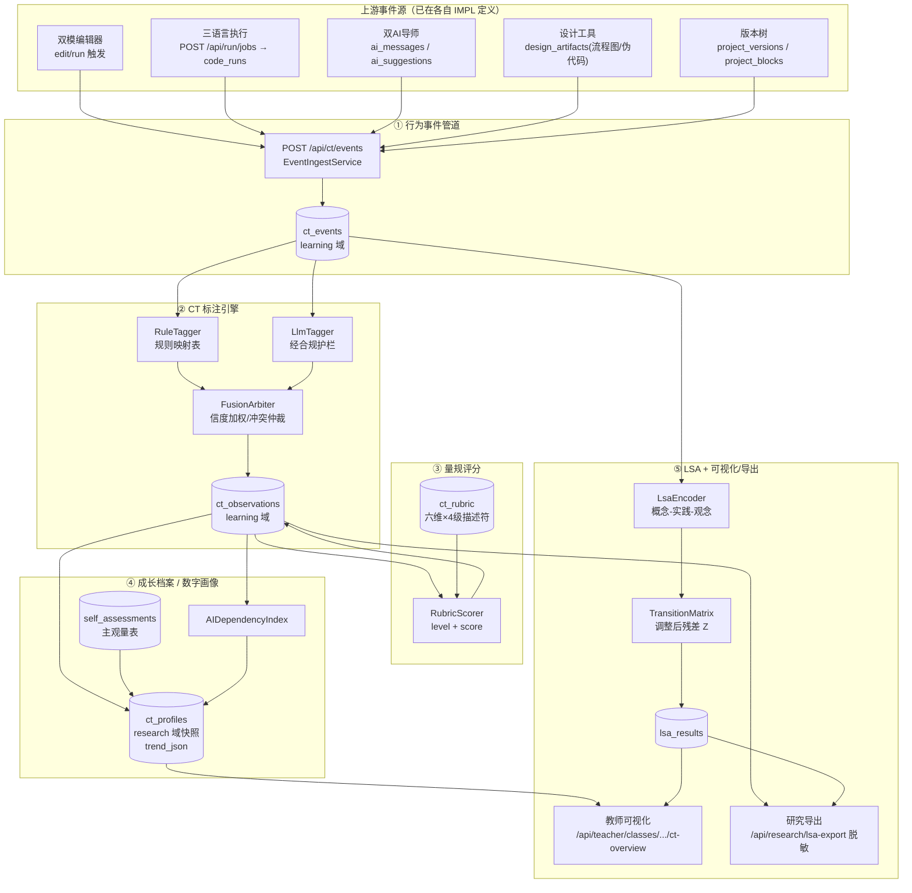

# IMPL · 计算思维六维过程评价体系 — 实现级设计

> **本文是《补充与优化升级_开发计划书与技术路线.md》§4.6「计算思维过程记录与评价」的实现级展开。**
> 上层文档给出方向（六维量规 + 行为事件管道 + CT 标注（规则+LLM）+ 滞后序列分析 + 成长档案 + 数字画像，并指出"扩成六维 + 持久化 + LSA"）。本文落到具体的事件 schema、量规描述符表、规则映射表、LLM 标注 Prompt 与输出 JSON Schema、规则×LLM 融合算法、LSA 的可运行 numpy 实现、SQL DDL、API 请求/响应 Schema、效度校准与逐条验收，**工程师可直接照此编码**。
>
> 版本：V1.0 ｜ 编写日期：2026-06-22 ｜ 技术栈：FastAPI + Pydantic v2 + PostgreSQL（PoC 阶段沿用 `data/mock-db.json` / SQLite 适配器，生产切 PG）
> 对象：面向**初中信息科技**的结对编程智能体平台。本子系统是课题"过程性评价 + 数字画像 + 滞后序列分析"的命脉。
>
> **计算思维六维（评价观测指标，不可改）**：抽象（Abstraction）、分解（Decomposition）、建模（Modeling）、算法设计（Algorithm Design）、验证与优化（Verification & Optimization）、迁移（Transfer）。

---

## 0. 设计原则（贯穿全篇，逐条可追溯）

| 原则 | 在本设计中的落地 |
|---|---|
| **从代码演化重建思考路径** | 不只查语法。评价证据来自"行为事件序列 + 跨版本代码 diff + 设计产物 + 运行/报错/修复链 + AI 求助/采纳"，由标注引擎从演化轨迹反推六维表现，而非单点快照打分。 |
| **过程 × 结果双轨** | 既评"做出来了没有"（结果：运行通过/任务完成），更评"怎么想、怎么改、怎么迁"（过程：事件转换、修复路径、设计先行）。量规每维既有结果性描述符也有过程性描述符。 |
| **主观量表 × 交互数据双维** | 学生自评量表（`self_assessments`）与系统客观交互数据（`ct_observations`）独立采集，在画像层按可信度加权合成，且**始终分开可视**（防自评虚高污染）。 |
| **规则 + LLM 双通道、可解释** | 规则通道确定、可审计、零成本；LLM 通道覆盖语义复杂场景。两者融合，每条结论都绑定 `evidence_ref`（具体事件/代码片段/版本 diff），教师可下钻复核。 |
| **合规前置、不可绕过** | 任何 LLM 标注调用必须经 `specs/IMPL-数据安全合规-实现级设计.md` 的输入/输出护栏（`InputGuard.check` → LLM → `OutputGuard.audit`）；标注输入为脱敏文本，标注结论**绝不向学生暴露隐性推理链**，仅向教师/课题组呈现可读摘要。 |
| **默认保守、低置信不写库** | 标注置信度低于阈值不生成 `ct_observation`（宁缺毋滥，保证论文证据质量）；规则与 LLM 冲突时按既定仲裁，并标记 `needs_review` 供人工抽检。 |

---

## 1. 总体架构

### 1.1 五段流水线

```
①行为事件管道            ②CT 标注引擎(规则+LLM)        ③量规评分           ④成长档案/数字画像        ⑤教师可视化 & 研究导出
─────────────         ──────────────────────       ─────────         ─────────────────       ───────────────────
编辑器/运行/AI导师/      规则映射(确定/可审计)            维度×水平描述符      六维雷达时间快照            班级六维分布/漏斗
设计工具 埋点            ＋ LLM 语义标注(经护栏)           匹配 → level(1..4)   CT标签叠代码版本时间线      个体下钻
   │                      │  融合(信度加权/仲裁)            ＋ 证据绑定          AI依赖风险指数             LSA 显著转换导出(脱敏)
   ▼                      ▼                              ▼                  自评×交互双维合成            CSV/JSON
ct_events ──────────► ct_observations ─────────────► (写回 observation) ──► ct_profiles ──────────────► /api/research/lsa-export
(learning 域)          (learning 域)                   level/score          (research 域快照)            (research 域, 脱敏)
   │
   └──────────────► LSA 编码器(概念-实践-观念) ──► 转移频次矩阵 ──► 调整后残差 Z ──► lsa_results
```

### 1.2 架构图（组件与上下游咬合）



### 1.3 包结构（FastAPI）

CT 评价子系统是一个独立包 `app/ct/`，与合规包 `app/compliance/` 正交（前者管"思维评价"，后者管"对话/数据/未成年人合规"），但**LLM 调用强制经合规护栏**。

```
app/ct/
├── __init__.py
├── events/
│   ├── models.py            # CtEvent ORM
│   ├── schema.py            # 统一 payload Pydantic 模型（按 event_type 判别联合）
│   └── ingest.py            # EventIngestService（埋点上报落库 + 触发异步标注）
├── tagging/
│   ├── rules.py             # RuleTagger + 规则映射表（§4.1）
│   ├── llm.py               # LlmTagger（Prompt + 输出 JSON Schema + 护栏调用，§4.2）
│   ├── fusion.py            # FusionArbiter（信度加权 + 冲突仲裁，§4.3）
│   └── evolution.py         # CodeEvolutionAnalyzer（跨版本 diff → 演化特征）
├── rubric/
│   ├── loader.py            # 从 ct_rubric 装载六维×水平描述符
│   └── scorer.py            # RubricScorer：observation → level/score
├── profile/
│   ├── builder.py           # ProfileBuilder：六维快照 + trend_json
│   ├── dependency.py        # AIDependencyIndex（§6.3 公式）
│   └── compose.py           # 自评×交互双维合成
├── lsa/
│   ├── encoder.py           # 概念-实践-观念 三维编码（§5.1）
│   ├── analysis.py          # 转移矩阵 + 调整后残差 Z（numpy，§5.2）
│   └── export.py            # 研究导出（脱敏，经合规 DeidentExporter）
├── config.py
└── routers/
    ├── ct_events.py         # POST /api/ct/events
    ├── student_profile.py   # GET /api/student/{id}/ct-profile
    ├── teacher_overview.py  # GET /api/teacher/classes/{id}/ct-overview
    └── research_lsa.py      # GET /api/research/lsa-export
```

### 1.4 同步/异步边界

- **埋点上报**（`POST /api/ct/events`）走**快路径**：仅校验 + 落 `ct_events`，立即 `202` 返回，避免阻塞编辑器交互。
- **标注与评分**走**慢路径**：由 `ingest` 投递到后台队列（PoC 用 FastAPI `BackgroundTasks`，生产用 Celery/RQ）。`RuleTagger` 实时（毫秒级）；`LlmTagger` 批量（按会话或按版本提交窗口聚合，降低 LLM 调用次数与成本）。
- **画像快照**由调度任务周期生成（每堂课结束 / 每日），写 `ct_profiles`（research 域），不实时重算。

---

## 2. 行为事件分类法与 schema（`ct_events`）

### 2.1 事件类型表

事件统一进 `ct_events`，`event_type` 是判别字段；`stage` 标注所处问题解决阶段（与课题"问题分析→程序设计→调试优化"三阶段对齐，用于 LSA 与量规情境化）。

| event_type | 触发源 | 语义 | 关键上下文引用 | 主关联维度（初判） |
|---|---|---|---|---|
| `task_open` | 编辑器 | 打开/接受一个任务 | `task_id` | —（情境锚点） |
| `design_create` | 设计工具 | 新建流程图/伪代码/思维导图 | `artifact_id`,`artifact_type` | 建模、抽象 |
| `design_update` | 设计工具 | 修改设计产物 | `artifact_id` | 建模 |
| `edit` | 编辑器 | 代码/积木编辑（去抖聚合） | `version_id`,`language`,`mode` | 算法设计、分解 |
| `block_compose` | 编辑器 | 积木拼装（Python 块模式） | `version_id`,`blockly_xml_ref` | 分解、算法设计 |
| `version_save` | 版本树 | 保存一个版本 | `version_id`,`hasBlockOrigin` | —（演化锚点） |
| `run` | 三语言执行 | 发起运行 | `run_id`,`job_id`,`language` | 验证与优化 |
| `run_result` | 三语言执行 | 运行结果回填 | `run_id`,`status`,`duration_ms` | 验证与优化 |
| `error` | 三语言执行 | 运行/编译报错 | `run_id`,`error_locator`,`error_kind` | 验证与优化 |
| `fix` | 编辑器 | 报错后定向修改并再次运行 | `from_version_id`,`to_version_id`,`run_id` | 验证与优化、算法设计 |
| `refactor` | 编辑器 | 非报错驱动的结构性改写（抽函数/改算法） | `from_version_id`,`to_version_id` | 算法设计、抽象、优化 |
| `ai_help` | AI 导师 | 向 AI 求助 | `ai_message_id`,`conversation_id` | —（依赖信号） |
| `ai_suggestion` | AI 导师 | AI 给出提示/建议 | `ai_suggestion_id`,`suggestion_kind` | —（支架信号） |
| `ai_adopt` | AI 导师 | 采纳 AI 建议（写入代码） | `ai_suggestion_id`,`to_version_id` | 依赖信号（含迁移：把建议迁到变体） |
| `ai_reject` | AI 导师 | 明确拒绝/未采纳 | `ai_suggestion_id` | 自主性信号 |
| `role_switch` | 协作 | 驾驶员/观察员换位 | `pair_session_id`,`new_role` | —（协作情境） |
| `transfer_apply` | 编辑器 | 把已掌握解法迁到变体/新题 | `source_task_id`,`task_id` | 迁移 |
| `submit` | 编辑器 | 提交作品 | `version_id`,`task_id` | 结果锚点（全维度收敛点） |
| `self_assess` | 量表 | 学生自评提交 | `self_assessment_id` | 主观量表入口 |

> 说明：`event_type` 不直接等于维度标签；维度由标注引擎（§4）从事件**及其上下文与演化关系**推断。上表"主关联维度"仅为规则映射的先验提示，非最终结论。

### 2.2 统一 payload schema（Pydantic v2 判别联合）

所有事件共享信封字段，`payload` 按 `event_type` 走判别联合（discriminated union），保证类型安全且可演进。

```python
# app/ct/events/schema.py
from __future__ import annotations
from datetime import datetime
from typing import Literal, Annotated, Union, Optional
from pydantic import BaseModel, Field

Stage = Literal["analysis", "design", "coding", "debugging", "reflection"]
# analysis=问题分析, design=程序设计, coding=编码, debugging=调试优化, reflection=回顾迁移

class EventEnvelope(BaseModel):
    """所有 ct_events 的统一信封。"""
    event_id: str = Field(default_factory=lambda: __import__("uuid").uuid4().hex)
    student_id: str                       # 主体（教师视图按假名展示）
    pair_session_id: Optional[str] = None # 结对会话（人-机或人-人）
    task_id: Optional[str] = None         # 任务情境锚点
    project_id: Optional[str] = None
    stage: Stage = "coding"
    client_ts: datetime                   # 客户端时间戳（埋点发生时刻）
    seq: int = 0                          # 同一 student 单调序号（保证 LSA 顺序，防乱序）
    # event_type + payload 见下方判别联合

# ---- 各事件 payload ----
class DesignCreatePayload(BaseModel):
    event_type: Literal["design_create"]
    artifact_id: str
    artifact_type: Literal["flowchart", "pseudocode", "mindmap"]
    node_count: int = 0
    edge_count: int = 0

class EditPayload(BaseModel):
    event_type: Literal["edit"]
    version_id: Optional[str] = None      # 关联草稿版本（未保存时可空）
    language: Literal["python", "cpp", "c"]
    mode: Literal["block", "code"] = "code"
    chars_added: int = 0
    chars_removed: int = 0

class RunResultPayload(BaseModel):
    event_type: Literal["run_result"]
    run_id: str                           # 关联 code_runs / job
    job_id: Optional[str] = None
    language: Literal["python", "cpp", "c"]
    status: Literal["completed", "rejected", "error"]
    duration_ms: int = 0
    has_canvas: bool = False              # 是否产出绘图（turtle）

class ErrorPayload(BaseModel):
    event_type: Literal["error"]
    run_id: str
    error_kind: Literal["syntax", "runtime", "compile", "timeout", "sandbox_blocked", "wrong_output"]
    error_line: Optional[int] = None      # 来自 RunResult.errorLocator
    error_signature: Optional[str] = None # 归一化错误指纹（去除变量名，用于"同错重复"统计）

class FixPayload(BaseModel):
    event_type: Literal["fix"]
    from_version_id: str
    to_version_id: str
    run_id: Optional[str] = None          # 修复后的复跑
    targeted_error_line: Optional[int] = None  # 是否定位到报错行附近
    resolved: bool = False                # 修复是否使错误消失

class RefactorPayload(BaseModel):
    event_type: Literal["refactor"]
    from_version_id: str
    to_version_id: str
    kind: Literal["extract_function", "loop_introduced", "decomposed_steps",
                  "renamed_meaningful", "algorithm_changed", "other"]

class AiEventPayload(BaseModel):
    event_type: Literal["ai_help", "ai_suggestion", "ai_adopt", "ai_reject"]
    ai_message_id: Optional[str] = None
    ai_suggestion_id: Optional[str] = None
    conversation_id: Optional[str] = None
    suggestion_kind: Optional[Literal["question", "hint", "pseudocode", "local_example"]] = None
    to_version_id: Optional[str] = None   # ai_adopt 写入的版本

class TransferPayload(BaseModel):
    event_type: Literal["transfer_apply"]
    source_task_id: str                   # 迁移来源题
    similarity: Optional[float] = None    # 与来源解法的结构相似度（0..1，由 diff/AST 估）

class SubmitPayload(BaseModel):
    event_type: Literal["submit"]
    version_id: str
    passed: Optional[bool] = None         # 判题结果（若有）

class GenericPayload(BaseModel):
    event_type: Literal["task_open", "design_update", "block_compose",
                         "version_save", "run", "role_switch", "self_assess"]
    ref_id: Optional[str] = None          # 通用引用（artifact_id/version_id/...）
    extra: dict = Field(default_factory=dict)

CtEventPayload = Annotated[
    Union[DesignCreatePayload, EditPayload, RunResultPayload, ErrorPayload,
          FixPayload, RefactorPayload, AiEventPayload, TransferPayload,
          SubmitPayload, GenericPayload],
    Field(discriminator="event_type"),
]

class CtEventIn(EventEnvelope):
    payload: CtEventPayload

class CtEventBatchIn(BaseModel):
    """编辑器可批量上报，减少请求数。"""
    events: list[CtEventIn]
```

### 2.3 与上游事件源的衔接约定（关键）

| 维度证据 | 来源表/接口 | 衔接字段 | 约定 |
|---|---|---|---|
| 运行/报错/修复（验证与优化） | `code_runs`（`POST /api/run/jobs` → `job.result`） | `ct_events.payload.run_id = code_runs.id`；`error_line` 取自 `RunResult.errorLocator.line` | 运行事件由执行服务在 job 终态回调时**反向投递** `run_result`/`error`，编辑器仅投递 `run`（发起）。 |
| 设计产物（建模） | `design_artifacts(id, project_id, type, payload_json)`（`POST /api/projects/{id}/design`） | `ct_events.payload.artifact_id = design_artifacts.id` | 设计工具保存即投递 `design_create`/`design_update`；流程图节点/边数从 `payload_json` 抽取入 `node_count/edge_count`。 |
| AI 求助/采纳（依赖/迁移信号） | `ai_messages` / `ai_suggestions` | `ai_message_id` / `ai_suggestion_id` | AI 导师链在合规护栏放行后投递 `ai_help`/`ai_suggestion`；学生把建议写入代码时投递 `ai_adopt(to_version_id)`。 |
| 代码演化（算法设计/抽象/分解） | `project_versions` / `project_blocks` | `version_id`、`from/to_version_id`、`hasBlockOrigin` | `version_save` 由编辑器保存触发；`fix`/`refactor` 携带 `from/to_version_id`，标注引擎据此取两版做 diff（§4.4）。 |

---

## 3. 六维表现性评价量规（核心交付）

每维 **4 个水平**（L1 萌芽 → L2 初步 → L3 熟练 → L4 迁移），每格给出"**表现特征**（描述符）+ **可观测证据**（可直接由事件/演化判定）"。量规以数据形式落 `ct_rubric` 表（§7），下表为初始词条（课题组可校准微调）。

> 评分锚点：L1=1 分，L2=2，L3=3，L4=4。维度得分 = 该维全部 observation 的水平按时间衰减加权聚合（§4.5）。

### 3.1 抽象（Abstraction）

| 水平 | 表现特征 | 可观测证据 |
|---|---|---|
| L1 萌芽 | 只关注具体数值/字面，未识别可变量与规律 | 代码全为硬编码常量；无变量命名或命名无意义（`a`,`b`,`x1`）；多处重复字面量 |
| L2 初步 | 能用变量替代部分常量，识别单一规律 | 引入 ≥1 个有意义变量替换重复字面量；`refactor.kind=renamed_meaningful` 出现 |
| L3 熟练 | 提炼参数/数据结构，忽略无关细节抓主要矛盾 | 用列表/字典等结构组织数据；把重复逻辑参数化；设计产物中用"输入-处理-输出"抽象描述问题 |
| L4 迁移 | 形成可复用抽象（函数签名/通用模型），跨情境稳定使用 | 定义带参数的通用函数并在变体题复用（`transfer_apply` + 函数复用）；抽象层级清晰且在新题中自发沿用 |

### 3.2 分解（Decomposition）

| 水平 | 表现特征 | 可观测证据 |
|---|---|---|
| L1 萌芽 | 把任务当作单一整块，无拆分 | 单一线性脚本、无函数/无步骤注释；设计产物缺失或仅一个节点 |
| L2 初步 | 能把任务口头/注释式分成几步 | 流程图/伪代码含 ≥2 个顺序步骤；代码出现分段注释 |
| L3 熟练 | 将问题拆为可独立处理的子任务并分别实现 | 定义 ≥2 个职责单一函数（`refactor.kind=extract_function`/`decomposed_steps`）；积木分组拼装 |
| L4 迁移 | 自顶向下分解 + 子任务接口清晰，分解策略跨题稳定 | 函数间通过参数/返回值清晰协作；在新题中先分解再实现（`design_create` 早于 `edit`，且分解粒度合理） |

### 3.3 建模（Modeling）—— 设计阶段产物为关键证据

| 水平 | 表现特征 | 可观测证据 |
|---|---|---|
| L1 萌芽 | 不做设计，直接动手写码 | 无 `design_create`；首个 `edit` 在 `task_open` 后即刻发生，无设计前置 |
| L2 初步 | 能画出简单流程/写出片段伪代码 | 有 `design_create`，但 `node_count` 少（≤3）或与最终代码弱相关 |
| L3 熟练 | 用流程图/伪代码完整表达解题方案，再据此编码 | `design_create` 早于主要 `edit`；流程图含分支/循环结构（`edge_count > node_count`）；设计与代码结构吻合 |
| L4 迁移 | 设计先行成为稳定习惯，模型可指导多种实现 | 多题均"先设计后编码"；设计产物经 `design_update` 迭代优化；同一模型映射到不同语言实现 |

### 3.4 算法设计（Algorithm Design）

| 水平 | 表现特征 | 可观测证据 |
|---|---|---|
| L1 萌芽 | 仅顺序执行，无控制结构 | 代码无循环/条件；积木仅顺序块 |
| L2 初步 | 能正确使用单一控制结构 | 出现循环或条件（`refactor.kind=loop_introduced`）；能跑出基本结果 |
| L3 熟练 | 组合多种结构，逻辑正确且有边界处理 | 嵌套/组合循环与条件；处理边界/异常输入；`submit.passed=true` 且结构合理 |
| L4 迁移 | 选择更优算法/数据结构，权衡复杂度 | 主动 `refactor.kind=algorithm_changed` 改进效率；同题给出更优解；能解释为何更优 |

### 3.5 验证与优化（Verification & Optimization）—— 运行/报错/修复链为关键证据

| 水平 | 表现特征 | 可观测证据 |
|---|---|---|
| L1 萌芽 | 写完不验证，或报错后无目标乱改 | 无 `run`；或报错后 `fix.targeted_error_line` 为空、反复同错（`error_signature` 重复 ≥3） |
| L2 初步 | 会运行查看结果，能改掉明显错误 | 有 `run`→`error`→`fix`→`run` 闭环；部分修复 `resolved=true` |
| L3 熟练 | 定位报错行精准修复，主动用样例验证 | `fix.targeted_error_line` 命中报错行附近；多用例验证；报错→修复中位时长下降 |
| L4 迁移 | 验证策略系统化 + 主动优化（非报错驱动的改进） | 出现非报错驱动的 `refactor`（性能/可读性）；自测覆盖边界；同错不二犯（`error_signature` 不复现） |

### 3.6 迁移（Transfer）

| 水平 | 表现特征 | 可观测证据 |
|---|---|---|
| L1 萌芽 | 每题从零开始，不复用既有经验 | 无 `transfer_apply`；新题解法与已掌握模式无关联 |
| L2 初步 | 在提示下能套用相似解法 | `transfer_apply` 仅在 `ai_suggestion` 后发生；`similarity` 高但依赖提示 |
| L3 熟练 | 自发把已掌握解法迁到变体题 | 无提示下 `transfer_apply`（前序无 `ai_help`）；`similarity ∈ [0.4,0.8]`（有改造非照搬） |
| L4 迁移 | 跨情境/跨语言迁移并适配，抽象出通用方法 | 把 Python 解法迁到 C/C++ 或迁到结构不同的新题并正确适配；AI 依赖随能力提升下降（fading 自然发生） |

### 3.7 量规使用约定

- 每条 `ct_observation` 必须落 `dimension + level(1..4) + evidence_ref + confidence`。
- **多证据汇聚**：同一维度可由多个事件证据共同支撑；评分器取时间衰减加权（§4.5），而非简单取最高，避免偶发高光拉高整体。
- **结果维 vs 过程维**：`submit.passed`、运行通过率属结果性证据；事件转换、修复路径、设计先行属过程性证据。量规描述符里两类并存，画像层分别呈现"过程分"与"结果分"。

---

## 4. CT 标注引擎

### 4.1 规则映射表（行为/代码演化模式 → 维度）

`RuleTagger` 对单事件或事件窗口（以 `task_id` + 时间窗聚合）应用确定性规则，输出候选 observation（`source="rule"`）。规则覆盖高确定性场景，零成本、可审计。

| 规则 ID | 触发模式（事件/演化） | → 维度 | 判定水平 | 证据绑定 |
|---|---|---|---|---|
| R-MOD-01 | `design_create` 早于该 task 首个 `edit`（设计先行） | 建模 | L3 | `artifact_id` + 首个 `edit.event_id` |
| R-MOD-02 | 流程图 `edge_count > node_count`（含分支/循环结构） | 建模 | L3 | `artifact_id` |
| R-MOD-03 | 同一 task 无任何 `design_*` 且直接 `edit` | 建模 | L1 | `task_id` |
| R-DEC-01 | `refactor.kind ∈ {extract_function, decomposed_steps}` | 分解 | L3 | `from/to_version_id` diff |
| R-DEC-02 | 跨版本 diff：函数数量从 ≤1 增至 ≥2 | 分解 | L3 | 版本 diff（§4.4） |
| R-DEC-03 | 设计产物含 ≥2 顺序步骤 | 分解 | L2 | `artifact_id` |
| R-ABS-01 | `refactor.kind=renamed_meaningful` 或硬编码常量被有名变量替换 | 抽象 | L2 | 版本 diff |
| R-ABS-02 | 引入列表/字典组织重复数据；或重复逻辑参数化 | 抽象 | L3 | 版本 diff |
| R-ALG-01 | `refactor.kind=loop_introduced`（首次出现控制结构） | 算法设计 | L2 | 版本 diff |
| R-ALG-02 | `refactor.kind=algorithm_changed` 且后续运行更快/通过 | 算法设计 | L4 | `from/to_version_id` + `run_result.duration_ms` |
| R-VER-01 | `run`→`error`→`fix(targeted_error_line 命中)`→`run(resolved)` 闭环 | 验证与优化 | L3 | 事件链 `run_id` 序列 |
| R-VER-02 | 报错后 `fix.targeted_error_line` 为空 且同 `error_signature` 重复 ≥3 | 验证与优化 | L1 | 重复 `error` 事件 |
| R-VER-03 | 非报错驱动的 `refactor`（前序无 `error`） | 验证与优化 | L4 | `refactor.event_id`（无前置 error） |
| R-TRF-01 | `transfer_apply` 且前序窗口**无** `ai_help`（自发迁移） | 迁移 | L3 | `source_task_id` + `task_id` |
| R-TRF-02 | `transfer_apply` 跨语言（来源 `python`，目标 `cpp/c`） | 迁移 | L4 | 两 task 的 `language` |
| R-TRF-03 | `transfer_apply` 紧跟 `ai_suggestion`（提示下迁移） | 迁移 | L2 | `ai_suggestion_id` + `transfer_apply` |
| R-DEP-01* | `ai_adopt` 占比高且 `ai_adopt` 后无自主 `edit`（直接采纳照搬） | （依赖信号，喂 §6.3） | — | `ai_suggestion_id` + `to_version_id` |

> 规则水平是**先验锚点**；当 LLM 给出更高置信的不同水平时，按 §4.3 仲裁。带 `*` 的 R-DEP-01 不直接产 observation，而是供 AI 依赖风险指数（§6.3）。

### 4.2 LLM 标注

`LlmTagger` 处理规则难以覆盖的语义场景（如"代码改写是否体现了抽象""自然语言设计是否表达了清晰模型"）。**强制经合规护栏**：输入先过 `InputGuard.check`（脱敏），输出过 `OutputGuard.audit`（裁链、对齐）；标注用的代码/设计文本一律为脱敏后内容。

#### 4.2.1 Prompt 设计

```python
# app/ct/tagging/llm.py（Prompt 模板，集中在 config/ct_prompt.yaml 便于校准）
SYSTEM_PROMPT = """\
你是初中信息科技计算思维过程评价助手。给定一名学生在一个任务上的【行为事件序列】与【代码演化片段】，
请判断其在计算思维六维（抽象/分解/建模/算法设计/验证与优化/迁移）上的表现。

严格要求：
1) 只依据提供的事件与代码证据判断，不臆测；证据不足的维度不要输出。
2) 每个判断必须绑定到具体证据（事件 id 或代码片段），给出水平(1-4)与置信度(0-1)。
3) 用初中教学语言写 rationale，简短、面向教师，不暴露你的推理过程细节。
4) 仅输出 JSON，不要解释 JSON 之外的内容。
水平定义（与量规一致）：1=萌芽 2=初步 3=熟练 4=迁移。
"""

USER_TEMPLATE = """\
任务情境: {task_brief}
阶段: {stage}
行为事件序列(已脱敏):
{events_digest}

代码演化(diff，已脱敏):
{code_diff}

设计产物(若有，已脱敏):
{design_digest}

请按 JSON Schema 输出六维中**有证据**的维度标注。
"""
```

#### 4.2.2 输出 JSON Schema（强约束 + 证据绑定）

```json
{
  "$schema": "http://json-schema.org/draft-07/schema#",
  "title": "CtLlmAnnotation",
  "type": "object",
  "required": ["annotations", "model_version"],
  "properties": {
    "model_version": { "type": "string" },
    "annotations": {
      "type": "array",
      "items": {
        "type": "object",
        "required": ["dimension", "level", "confidence", "evidence_ref", "rationale"],
        "properties": {
          "dimension": {
            "type": "string",
            "enum": ["abstraction","decomposition","modeling",
                     "algorithm_design","verification_optimization","transfer"]
          },
          "level": { "type": "integer", "minimum": 1, "maximum": 4 },
          "confidence": { "type": "number", "minimum": 0, "maximum": 1 },
          "evidence_ref": {
            "type": "object",
            "description": "证据绑定：事件id列表与/或代码片段范围",
            "properties": {
              "event_ids": { "type": "array", "items": { "type": "string" } },
              "version_ids": { "type": "array", "items": { "type": "string" } },
              "code_span": { "type": "string", "description": "脱敏代码引用片段（可空）" }
            }
          },
          "rationale": { "type": "string", "maxLength": 200 }
        },
        "additionalProperties": false
      }
    }
  },
  "additionalProperties": false
}
```

#### 4.2.3 调用与解析（经护栏、可解释、不暴露推理）

```python
# app/ct/tagging/llm.py
import json
from dataclasses import dataclass

@dataclass
class LlmAnnotation:
    dimension: str
    level: int
    confidence: float
    evidence_ref: dict
    rationale: str
    source: str = "llm"

class LlmTagger:
    def __init__(self, llm_client, input_guard, output_guard, cfg, audit):
        self.llm, self.ig, self.og, self.cfg, self.audit = llm_client, input_guard, output_guard, cfg, audit

    def annotate(self, ctx, task_brief, events_digest, code_diff, design_digest) -> list[LlmAnnotation]:
        # 1) 合规护栏：标注输入脱敏（复用 InputGuard，仅取脱敏文本，不触发对话风控阻断逻辑）
        safe_events = self.ig.redact_for_annotation(events_digest)
        safe_diff   = self.ig.redact_for_annotation(code_diff)
        safe_design = self.ig.redact_for_annotation(design_digest)
        prompt = USER_TEMPLATE.format(task_brief=task_brief, stage=ctx.stage,
                                      events_digest=safe_events, code_diff=safe_diff,
                                      design_digest=safe_design)
        # 2) 调 LLM（JSON mode / 工具调用约束 schema）
        raw = self.llm.complete_json(system=SYSTEM_PROMPT, user=prompt,
                                     schema_name="CtLlmAnnotation",
                                     temperature=0.0)  # 评价任务取 0 温度，稳定可复现
        # 3) 输出护栏：裁链 + 对齐（评价摘要不得含隐性推理链）
        audited = self.og.audit_annotation(raw, ctx)
        data = json.loads(audited)
        self.audit.log(actor="system", action="ct.llm_annotate",
                       resource=ctx.task_id, ip="-",
                       payload={"model": data.get("model_version"),
                                "n": len(data.get("annotations", []))})
        # 4) 解析 + 阈值过滤（低置信不写库）
        out = []
        for a in data.get("annotations", []):
            if a["confidence"] < self.cfg.llm_min_confidence:   # 默认 0.5
                continue
            out.append(LlmAnnotation(a["dimension"], a["level"], a["confidence"],
                                     a["evidence_ref"], a["rationale"]))
        return out
```

### 4.3 规则与 LLM 的融合策略（信度加权 + 冲突仲裁）

**目标**：规则确定但覆盖窄、LLM 广但有噪声；融合既要利用规则的高可信，又要让 LLM 覆盖语义盲区，同时保证可解释与可审计。

**融合规则（按维度逐一裁决）**：

1. **仅规则命中** → 采纳规则水平，`source="rule"`，`confidence = rule_prior`（默认 0.9，规则高可信）。
2. **仅 LLM 命中** → 采纳 LLM，`source="llm"`，`confidence = llm_conf`（需 ≥ `llm_min_confidence`）。
3. **两者命中且水平一致** → `source="rule+llm"`，`confidence = 1 - (1-rule_prior)(1-llm_conf)`（噪声独立假设下的合取增益，更高），合并 `evidence_ref`。
4. **两者命中但水平冲突**：
   - 计算加权水平 `level* = round( (w_r·rule_prior·L_rule + w_l·llm_conf·L_llm) / (w_r·rule_prior + w_l·llm_conf) )`，默认权重 `w_r=0.6, w_l=0.4`（偏信规则）。
   - 若 `|L_rule - L_llm| >= 2`（强冲突）：取**较低**水平（默认保守），并置 `needs_review=true` 入抽检队列。
   - 若 `|L_rule - L_llm| == 1`：取 `level*`，`source="rule+llm"`，`confidence` 取两者较低值（反映不确定）。

```python
# app/ct/tagging/fusion.py
from dataclasses import dataclass

@dataclass
class FusedObservation:
    dimension: str
    level: int
    score: float            # = level（1..4），便于聚合
    confidence: float
    source: str             # rule | llm | rule+llm
    evidence_ref: dict
    rationale: str
    needs_review: bool = False

class FusionArbiter:
    def __init__(self, cfg):
        self.cfg = cfg  # rule_prior=0.9, w_r=0.6, w_l=0.4, strong_conflict_delta=2

    def fuse(self, dim: str, rule_ann, llm_ann) -> FusedObservation | None:
        rp, wr, wl = self.cfg.rule_prior, self.cfg.w_r, self.cfg.w_l
        if rule_ann and not llm_ann:
            return FusedObservation(dim, rule_ann.level, rule_ann.level, rp, "rule",
                                    rule_ann.evidence_ref, rule_ann.rationale)
        if llm_ann and not rule_ann:
            return FusedObservation(dim, llm_ann.level, llm_ann.level, llm_ann.confidence,
                                    "llm", llm_ann.evidence_ref, llm_ann.rationale)
        if rule_ann and llm_ann:
            ev = {**rule_ann.evidence_ref, **llm_ann.evidence_ref}
            if rule_ann.level == llm_ann.level:
                conf = 1 - (1 - rp) * (1 - llm_ann.confidence)
                return FusedObservation(dim, rule_ann.level, rule_ann.level, conf,
                                        "rule+llm", ev, llm_ann.rationale)
            delta = abs(rule_ann.level - llm_ann.level)
            if delta >= self.cfg.strong_conflict_delta:
                lvl = min(rule_ann.level, llm_ann.level)   # 默认保守取低
                return FusedObservation(dim, lvl, lvl, min(rp, llm_ann.confidence),
                                        "rule+llm", ev, llm_ann.rationale, needs_review=True)
            num = wr * rp * rule_ann.level + wl * llm_ann.confidence * llm_ann.level
            den = wr * rp + wl * llm_ann.confidence
            lvl = round(num / den)
            return FusedObservation(dim, lvl, lvl, min(rp, llm_ann.confidence),
                                    "rule+llm", ev, llm_ann.rationale)
        return None
```

### 4.4 代码演化分析（CodeEvolutionAnalyzer）—— 从演化重建思路

`fix`/`refactor`/`version_save` 携带 `from/to_version_id`；分析器取两版源码做 AST/结构 diff，输出"演化特征"喂给规则与 LLM，使评价基于**思路演变**而非语法快照。

```python
# app/ct/tagging/evolution.py（核心特征抽取，Python 用 ast；C/C++ 用轻量正则启发式）
import ast

def py_features(src: str) -> dict:
    try:
        tree = ast.parse(src)
    except SyntaxError:
        return {"parse_ok": False}
    funcs = [n for n in ast.walk(tree) if isinstance(n, ast.FunctionDef)]
    loops = [n for n in ast.walk(tree) if isinstance(n, (ast.For, ast.While))]
    conds = [n for n in ast.walk(tree) if isinstance(n, ast.If)]
    consts = [n for n in ast.walk(tree) if isinstance(n, ast.Constant)]
    names = [n.id for n in ast.walk(tree) if isinstance(n, ast.Name)]
    meaningful = [x for x in names if len(x) > 2 and not x.isdigit()]
    return {
        "parse_ok": True, "func_count": len(funcs), "loop_count": len(loops),
        "cond_count": len(conds), "const_count": len(consts),
        "meaningful_name_ratio": (len(set(meaningful)) / max(len(set(names)), 1)),
        "uses_struct": any(isinstance(n, (ast.List, ast.Dict, ast.Set)) for n in ast.walk(tree)),
    }

def diff_features(src_from: str, src_to: str, language="python") -> dict:
    f = py_features(src_from) if language == "python" else cpp_features(src_from)
    t = py_features(src_to)   if language == "python" else cpp_features(src_to)
    if not (f.get("parse_ok") and t.get("parse_ok")):
        return {"reliable": False}
    return {
        "reliable": True,
        "func_delta": t["func_count"] - f["func_count"],          # >0 → 分解证据
        "loop_introduced": f["loop_count"] == 0 and t["loop_count"] > 0,  # 算法设计 L2
        "struct_introduced": (not f["uses_struct"]) and t["uses_struct"], # 抽象 L3
        "naming_improved": t["meaningful_name_ratio"] - f["meaningful_name_ratio"] > 0.2,  # 抽象 L2
        "const_reduced": f["const_count"] - t["const_count"] > 0,         # 抽象（去硬编码）
    }
```

> C/C++ 的 `cpp_features` 用轻量正则（计 `for/while`、`if`、函数定义 `\w+\s+\w+\s*\([^;]*\)\s*\{`、数组/struct 使用），不接完整编译器前端（初中场景够用，成本可控）。

### 4.5 维度得分聚合（时间衰减加权）

```python
# app/ct/rubric/scorer.py（维度聚合：近期证据权重更高，体现成长）
import math
from datetime import datetime

def aggregate_dimension(observations: list, half_life_days=14.0, now=None) -> dict:
    """observations: 同一维度的 [{level, confidence, created_at}]，返回 {score, level, n}。"""
    now = now or datetime.now()
    num = den = 0.0
    for o in observations:
        age_days = (now - o["created_at"]).total_seconds() / 86400.0
        decay = 0.5 ** (age_days / half_life_days)          # 时间衰减
        w = o["confidence"] * decay
        num += w * o["level"]; den += w
    if den == 0:
        return {"score": None, "level": None, "n": 0}
    score = num / den                                        # 连续分 1..4
    return {"score": round(score, 2), "level": int(round(score)), "n": len(observations)}
```

---

## 5. 滞后序列分析（LSA）实现

### 5.1 编码方案（参照"概念—实践—观念"三维框架）

课题要求参照"概念—实践—观念"三维框架对行为序列结构化编码。每个 `ct_event` 映射到一个**行为编码**，编码由 `(三维框架类目, 具体行为)` 构成，作为 LSA 的状态符号。

| 三维框架 | 含义 | 行为编码（state code） | 对应事件 |
|---|---|---|---|
| **概念（Concept）** | 理解问题、形成方案的认知行为 | `C-ANALYZE`（分析任务） | `task_open`（停留分析）, `design_create` 前的思考 |
|  |  | `C-DESIGN`（设计建模） | `design_create`, `design_update` |
|  |  | `C-SEEK`（求助理解） | `ai_help`（提问类）, `ai_suggestion(kind=question/hint)` |
| **实践（Practice）** | 动手构造与执行的操作行为 | `P-CODE`（编写代码） | `edit`, `block_compose` |
|  |  | `P-RUN`（运行验证） | `run`, `run_result` |
|  |  | `P-DEBUG`（调试修复） | `error`, `fix` |
|  |  | `P-ADOPT`（采纳建议） | `ai_adopt` |
| **观念（Conception）** | 反思、评估、迁移的元认知行为 | `M-REFACTOR`（主动优化） | `refactor`（非报错驱动） |
|  |  | `M-TRANSFER`（迁移应用） | `transfer_apply` |
|  |  | `M-REFLECT`（反思自评） | `self_assess`, `submit` 后回看 |

> 编码表落 `config/lsa_coding.yaml`，课题组可调。一个事件可映射到一个主编码（取最具语义的类目）。

```python
# app/ct/lsa/encoder.py
EVENT_TO_CODE = {
    "task_open": "C-ANALYZE", "design_create": "C-DESIGN", "design_update": "C-DESIGN",
    "ai_help": "C-SEEK",
    "edit": "P-CODE", "block_compose": "P-CODE",
    "run": "P-RUN", "run_result": "P-RUN", "error": "P-DEBUG", "fix": "P-DEBUG",
    "ai_adopt": "P-ADOPT",
    "refactor": "M-REFACTOR", "transfer_apply": "M-TRANSFER",
    "self_assess": "M-REFLECT", "submit": "M-REFLECT",
}
STATES = ["C-ANALYZE","C-DESIGN","C-SEEK","P-CODE","P-RUN","P-DEBUG","P-ADOPT",
          "M-REFACTOR","M-TRANSFER","M-REFLECT"]

def encode_sequence(events: list[dict]) -> list[str]:
    """events 按 (student_id, seq, client_ts) 排序后映射为编码序列。"""
    seq = []
    for e in sorted(events, key=lambda x: (x["seq"], x["client_ts"])):
        code = EVENT_TO_CODE.get(e["event_type"])
        if code:
            seq.append(code)
    return seq
```

### 5.2 转移频次矩阵 + 调整后残差 Z 值（numpy 可运行）

LSA 核心：统计"行为 i 之后紧接行为 j"的转移频次，计算**调整后残差（adjusted residual）Z 值**判断哪些转换显著高于/低于随机期望（`|Z| > 1.96` 即 p<.05 显著）。

```python
# app/ct/lsa/analysis.py
import numpy as np

def transition_matrix(coded_seqs: list[list[str]], states: list[str]) -> np.ndarray:
    """多名学生的编码序列 → 一阶转移频次矩阵 F[i,j]（i→j 次数）。"""
    idx = {s: k for k, s in enumerate(states)}
    n = len(states)
    F = np.zeros((n, n), dtype=float)
    for seq in coded_seqs:
        for a, b in zip(seq[:-1], seq[1:]):
            if a in idx and b in idx:
                F[idx[a], idx[b]] += 1
    return F

def adjusted_residuals(F: np.ndarray) -> np.ndarray:
    """
    Allison & Liker (1982) 调整后残差：
      Z[i,j] = (F[ij] - E[ij]) / sqrt( E[ij] * (1 - Ri/N) * (1 - Cj/N) )
      E[ij] = Ri*Cj/N ，Ri 行和，Cj 列和，N 总转移数
    返回 Z 矩阵；|Z|>1.96 即该转换在 .05 水平显著。
    """
    N = F.sum()
    if N == 0:
        return np.zeros_like(F)
    R = F.sum(axis=1, keepdims=True)   # 行和 (n,1)
    C = F.sum(axis=0, keepdims=True)   # 列和 (1,n)
    E = R @ C / N                       # 期望频次 (n,n)
    with np.errstate(divide="ignore", invalid="ignore"):
        denom = np.sqrt(E * (1 - R / N) * (1 - C / N))
        Z = (F - E) / denom
    Z[np.isnan(Z)] = 0.0
    Z[np.isinf(Z)] = 0.0
    return Z

def significant_transitions(Z: np.ndarray, states: list[str], alpha_z=1.96) -> list[dict]:
    """导出显著转换列表，供论文与教师可视化。"""
    out = []
    for i in range(len(states)):
        for j in range(len(states)):
            if abs(Z[i, j]) > alpha_z:
                out.append({
                    "from": states[i], "to": states[j], "z": round(float(Z[i, j]), 3),
                    "direction": "facilitates" if Z[i, j] > 0 else "inhibits",
                    "significant": True,
                })
    return sorted(out, key=lambda x: -abs(x["z"]))

# ---- 用法（研究导出 / 班级分析） ----
def run_lsa(coded_seqs, states=STATES):
    F = transition_matrix(coded_seqs, states)
    Z = adjusted_residuals(F)
    return {
        "states": states,
        "frequency": F.astype(int).tolist(),
        "z_matrix": np.round(Z, 3).tolist(),
        "significant": significant_transitions(Z, states),
        "n_transitions": int(F.sum()),
    }
```

**论文用产物**：`run_lsa` 输出可直接渲染为转换图（显著正残差画实线箭头、负残差画虚线），并导出频次矩阵与 Z 矩阵 CSV。典型可解释结论：例如若 `C-DESIGN → P-CODE` 的 `Z` 显著为正，说明"先设计后编码"是稳定行为模式；若 `P-DEBUG → P-ADOPT`（报错即求助采纳）显著为正而 `P-DEBUG → P-DEBUG`（自主调试）不显著，提示该群体调试自主性弱、AI 依赖偏高。

### 5.3 LSA 的两种粒度

- **个体序列**（成长档案下钻）：单学生跨任务序列 → 个体行为模式。
- **群体序列**（班级/实验组研究）：拼接同组多学生序列 → 群体转换结构，支撑准实验组间对比（实验组 vs 对照组的显著转换差异）。

---

## 6. 成长档案 / 数字画像

### 6.1 六维雷达随时间快照（`ct_profiles.trend_json`）

`ProfileBuilder` 定期（每堂课/每日）对每生聚合当时的 `ct_observations`，写一条快照到 `ct_profiles`（research 域），`trend_json` 累积历史点，前端据此画"六维雷达 + 成长曲线"。

```python
# app/ct/profile/builder.py
DIMENSIONS = ["abstraction","decomposition","modeling",
              "algorithm_design","verification_optimization","transfer"]

def build_snapshot(student_id, observations, self_assess, dep_index, now) -> dict:
    radar = {}
    for d in DIMENSIONS:
        obs_d = [o for o in observations if o["dimension"] == d]
        radar[d] = aggregate_dimension(obs_d, now=now)   # {score, level, n}（§4.5）
    return {
        "student_id": student_id,
        "captured_at": now.isoformat(),
        "radar": radar,                                   # 客观交互数据维
        "self_assess": self_assess,                       # 主观量表维（独立呈现）
        "composite": compose_dual(radar, self_assess),    # 双维合成（§6.4）
        "ai_dependency_index": dep_index,                 # §6.3
    }
```

`trend_json` 结构（追加式时间序列，前端画成长曲线）：

```json
{
  "snapshots": [
    { "captured_at": "2026-03-01T10:00:00+08:00",
      "radar": { "abstraction": {"score":1.8,"level":2},
                 "decomposition": {"score":2.1,"level":2},
                 "modeling": {"score":1.5,"level":2},
                 "algorithm_design": {"score":2.0,"level":2},
                 "verification_optimization": {"score":1.7,"level":2},
                 "transfer": {"score":1.2,"level":1} },
      "self_assess": { "abstraction": 3, "...": 0 },
      "ai_dependency_index": 0.62 },
    { "captured_at": "2026-05-01T10:00:00+08:00",
      "radar": { "abstraction": {"score":2.9,"level":3}, "...": {} },
      "ai_dependency_index": 0.34 }
  ]
}
```

### 6.2 CT 标签叠加到代码版本时间线

`ct_observations` 携带 `version_id`/`from/to_version_id`，可把维度标签锚定到 `project_versions` 时间轴上，形成"哪一版改动体现了哪个维度的进步"的可视化——教师下钻时直接看到"第 3 版引入循环（算法设计 L2）→ 第 5 版抽出函数（分解 L3）→ 第 7 版迁到变体题（迁移 L3）"。

```sql
-- 教师下钻：某生某项目的版本-CT标签时间线
SELECT v.version_id, v.created_at, v.language,
       o.dimension, o.level, o.confidence, o.source, o.rationale
FROM learning.project_versions v
LEFT JOIN learning.ct_observations o ON o.version_id = v.version_id
WHERE v.student_id = :sid AND v.project_id = :pid
ORDER BY v.created_at;
```

### 6.3 AI 依赖风险指数（公式）

衡量"过度依赖 AI、削弱自主思维"的风险（课题要求防过度依赖）。综合"采纳频次高"与"自主运行少"两类信号，落 `ct_profiles.ai_dependency_index ∈ [0,1]`，越高越需关注。

```
设窗口（如一周/一任务）内：
  adopt   = ai_adopt 事件数
  help    = ai_help 事件数
  run_self= 自主 run 事件数（非紧跟 ai_adopt 的运行）
  edit_self = 自主 edit 字符量（非来自 ai_adopt 的代码注入）
  total_edit = 全部 edit 字符量

AIDependencyIndex =
    w1 * adopt_rate      # 采纳强度 = adopt / max(adopt + run_self, 1)
  + w2 * help_density    # 求助密度 = help / max(总事件数, 1) 归一
  + w3 * (1 - autonomy)  # 低自主 = 1 - edit_self / max(total_edit, 1)
  - w4 * fading_bonus    # 渐撤奖励：若依赖随时间下降(斜率<0) 则减分
默认权重 w1=0.4, w2=0.2, w3=0.3, w4=0.1，结果裁剪到 [0,1]。
```

```python
# app/ct/profile/dependency.py
def ai_dependency_index(window_stats: dict, trend_slope: float = 0.0,
                        w=(0.4, 0.2, 0.3, 0.1)) -> float:
    adopt = window_stats.get("adopt", 0)
    help_ = window_stats.get("help", 0)
    run_self = window_stats.get("run_self", 0)
    edit_self = window_stats.get("edit_self", 0)
    total_edit = max(window_stats.get("total_edit", 0), 1)
    n_events = max(window_stats.get("n_events", 0), 1)
    adopt_rate = adopt / max(adopt + run_self, 1)
    help_density = min(help_ / n_events, 1.0)
    low_autonomy = 1 - min(edit_self / total_edit, 1.0)
    fading_bonus = 1.0 if trend_slope < 0 else 0.0   # 依赖下降 → 奖励（降风险）
    idx = (w[0]*adopt_rate + w[1]*help_density + w[2]*low_autonomy - w[3]*fading_bonus)
    return round(max(0.0, min(1.0, idx)), 3)
```

> 该指数与合规子系统的"高危风控"正交：风控管对话安全，本指数管思维自主性，仅作教师提示（如"该生 AI 依赖偏高，建议增加独立练习"），不触发锁定/通知。

### 6.4 自评 × 交互数据双维合成

主观量表与客观交互数据**始终独立存储与呈现**，合成仅用于"一致性诊断"与综合排序，不互相覆盖。

```python
# app/ct/profile/compose.py
def compose_dual(radar: dict, self_assess: dict, w_obj=0.7, w_subj=0.3) -> dict:
    """返回每维 {objective, subjective, composite, gap}。gap 大 → 自我认知偏差，供反馈。"""
    out = {}
    for d, obj in radar.items():
        o = obj.get("score")
        s = self_assess.get(d)                       # 学生自评 1..4
        comp = None
        if o is not None and s is not None:
            comp = round(w_obj * o + w_subj * s, 2)
        out[d] = {"objective": o, "subjective": s, "composite": comp,
                  "gap": (None if (o is None or s is None) else round(s - o, 2))}
    return out
```

> `gap > 0`（自评高于客观）提示自我高估，是教师反馈与元认知干预的切入点；`gap < 0`（自评低于客观）提示信心不足。两者都是有价值的成长信号，写入画像供下钻。

---

## 7. 数据模型（SQL DDL）

> 与合规文档一致：`learning` 域存行为/观察（脱敏后），`research` 域存画像快照与 LSA 结果（去标识）。PoC 阶段以 `data/mock-db.json` 顶层数组镜像下列表。所有 `student_id` 在 research 域以假名 `subject` 形式导出（§8.4）。

```sql
-- ========== schema: learning ==========
CREATE SCHEMA IF NOT EXISTS learning;

-- 7.1 行为事件
CREATE TABLE learning.ct_events (
    event_id        UUID PRIMARY KEY,
    student_id      UUID NOT NULL,
    pair_session_id UUID,
    task_id         UUID,
    project_id      UUID,
    stage           VARCHAR(16) NOT NULL DEFAULT 'coding',
    event_type      VARCHAR(24) NOT NULL,
    seq             BIGINT NOT NULL DEFAULT 0,        -- 单生单调序号，保证 LSA 顺序
    payload         JSONB NOT NULL DEFAULT '{}',      -- 见 §2.2 判别联合
    -- 冗余抽取的高频引用列（便于索引与 JOIN，避免每次解 JSONB）
    version_id      UUID,
    run_id          UUID,
    artifact_id     UUID,
    ai_message_id   UUID,
    ai_suggestion_id UUID,
    client_ts       TIMESTAMPTZ NOT NULL,
    created_at      TIMESTAMPTZ NOT NULL DEFAULT now(),
    CONSTRAINT ck_event_stage CHECK (stage IN
        ('analysis','design','coding','debugging','reflection'))
);
CREATE INDEX ix_ctev_student_seq   ON learning.ct_events (student_id, seq);
CREATE INDEX ix_ctev_task          ON learning.ct_events (task_id, client_ts);
CREATE INDEX ix_ctev_type_time     ON learning.ct_events (event_type, client_ts);
CREATE INDEX ix_ctev_version       ON learning.ct_events (version_id);
CREATE INDEX ix_ctev_run           ON learning.ct_events (run_id);

-- 7.2 维度观察（标注引擎输出）
CREATE TABLE learning.ct_observations (
    id              UUID PRIMARY KEY,
    student_id      UUID NOT NULL,
    task_id         UUID,
    dimension       VARCHAR(28) NOT NULL,             -- abstraction/.../transfer
    level           SMALLINT NOT NULL,                -- 1..4
    score           NUMERIC(4,2),                     -- 连续分（聚合用），通常 = level
    confidence      NUMERIC(4,3) NOT NULL,            -- 0..1
    source          VARCHAR(12) NOT NULL,             -- rule | llm | rule+llm
    rubric_id       UUID,                             -- 命中的量规条目
    evidence_ref    JSONB NOT NULL,                   -- {event_ids,version_ids,code_span,rule_id}
    version_id      UUID,                             -- 锚定代码版本时间线（§6.2）
    rationale       VARCHAR(256),
    needs_review    BOOLEAN NOT NULL DEFAULT false,   -- 强冲突待人工抽检
    created_at      TIMESTAMPTZ NOT NULL DEFAULT now(),
    CONSTRAINT ck_ct_dim CHECK (dimension IN
        ('abstraction','decomposition','modeling',
         'algorithm_design','verification_optimization','transfer')),
    CONSTRAINT ck_ct_level CHECK (level BETWEEN 1 AND 4)
);
CREATE INDEX ix_ctobs_student_dim ON learning.ct_observations (student_id, dimension, created_at DESC);
CREATE INDEX ix_ctobs_review      ON learning.ct_observations (needs_review) WHERE needs_review = true;
CREATE INDEX ix_ctobs_version     ON learning.ct_observations (version_id);

-- 7.3 量规（六维 × 水平描述符；数据驱动评分）
CREATE TABLE learning.ct_rubric (
    id              UUID PRIMARY KEY,
    dimension       VARCHAR(28) NOT NULL,
    level           SMALLINT NOT NULL,                -- 1..4
    descriptor      TEXT NOT NULL,                    -- 表现特征
    evidence_spec   TEXT NOT NULL,                    -- 可观测证据（人读）
    rule_hints      JSONB,                            -- 关联规则ID（机读，喂 RuleTagger）
    version         VARCHAR(16) NOT NULL DEFAULT 'v1',-- 量规版本（校准可迭代）
    updated_at      TIMESTAMPTZ NOT NULL DEFAULT now(),
    CONSTRAINT ux_rubric UNIQUE (dimension, level, version),
    CONSTRAINT ck_rub_level CHECK (level BETWEEN 1 AND 4)
);

-- 7.4 学生自评（主观量表，独立于客观观察）
CREATE TABLE learning.self_assessments (
    id              UUID PRIMARY KEY,
    student_id      UUID NOT NULL,
    task_id         UUID,
    scores          JSONB NOT NULL,                   -- {abstraction:3, decomposition:2, ...} 1..4
    reflection      TEXT,                             -- 自由反思（脱敏后入 research）
    submitted_at    TIMESTAMPTZ NOT NULL DEFAULT now()
);
CREATE INDEX ix_self_student ON learning.self_assessments (student_id, submitted_at DESC);

-- ========== schema: research（去标识画像与研究产物） ==========
CREATE SCHEMA IF NOT EXISTS research;

-- 7.5 数字画像快照
CREATE TABLE research.ct_profiles (
    id              UUID PRIMARY KEY,
    student_id      UUID NOT NULL,                    -- research 域内部主键；导出时假名化
    captured_at     TIMESTAMPTZ NOT NULL DEFAULT now(),
    radar           JSONB NOT NULL,                   -- 当下六维 {dim:{score,level,n}}
    trend_json      JSONB NOT NULL DEFAULT '{"snapshots":[]}',  -- 历史序列（成长曲线）
    self_assess     JSONB,                            -- 主观维快照
    composite       JSONB,                            -- 双维合成 {dim:{objective,subjective,composite,gap}}
    ai_dependency_index NUMERIC(4,3),
    updated_at      TIMESTAMPTZ NOT NULL DEFAULT now()
);
CREATE UNIQUE INDEX ux_profile_student ON research.ct_profiles (student_id);  -- 最新快照；历史在 trend_json

-- 7.6 LSA 结果（个体/群体）
CREATE TABLE research.lsa_results (
    id              UUID PRIMARY KEY,
    scope           VARCHAR(12) NOT NULL,             -- student | class | group
    scope_ref       VARCHAR(64) NOT NULL,             -- student_id(假名) / class_id / group_label
    states          JSONB NOT NULL,                   -- 状态符号列表
    frequency       JSONB NOT NULL,                   -- 转移频次矩阵
    z_matrix        JSONB NOT NULL,                   -- 调整后残差 Z 矩阵
    significant     JSONB NOT NULL,                   -- 显著转换列表（|Z|>1.96）
    n_transitions   INTEGER NOT NULL,
    coding_version  VARCHAR(16) NOT NULL DEFAULT 'v1',-- 编码方案版本
    computed_at     TIMESTAMPTZ NOT NULL DEFAULT now(),
    CONSTRAINT ck_lsa_scope CHECK (scope IN ('student','class','group'))
);
CREATE INDEX ix_lsa_scope ON research.lsa_results (scope, scope_ref, computed_at DESC);
```

> 索引取舍：`ct_events` 按 `(student_id, seq)` 建主查询索引（LSA 取序）、按 `version_id/run_id` 建 JOIN 索引（标注引擎取演化/运行证据）。`ct_observations` 按 `(student_id, dimension, created_at)` 支撑画像聚合（§4.5 时间衰减聚合的扫描）。

---

## 8. API 契约

> 统一鉴权头：`X-CodeX-Session`（沿用 Phase 2J）。学生端核心接口经合规 `require_active_consent` + `enforce_usage_limits`。研究接口经 `require_courseteam` + 脱敏导出。错误统一 `{ "detail": { "code", "message", ... } }`。

### 8.1 `POST /api/ct/events`（埋点上报）

支持单条或批量（`events[]`）。快路径：仅落库 + 投递异步标注，立即 `202`。

请求：

```json
{
  "events": [
    {
      "student_id": "stu_001",
      "task_id": "task_42",
      "project_id": "proj_9",
      "stage": "design",
      "seq": 1017,
      "client_ts": "2026-06-22T10:03:11+08:00",
      "payload": { "event_type": "design_create", "artifact_id": "art_7",
                   "artifact_type": "flowchart", "node_count": 6, "edge_count": 7 }
    },
    {
      "student_id": "stu_001",
      "task_id": "task_42",
      "stage": "debugging",
      "seq": 1031,
      "client_ts": "2026-06-22T10:09:50+08:00",
      "payload": { "event_type": "fix", "from_version_id": "v_88", "to_version_id": "v_89",
                   "run_id": "run_55", "targeted_error_line": 12, "resolved": true }
    }
  ]
}
```

响应 `202`：

```json
{ "accepted": 2, "rejected": 0, "queued_for_tagging": ["task_42"] }
```

校验失败（payload 与 `event_type` 不符）逐条返回 `{ "index": 1, "code": "PAYLOAD_SCHEMA_MISMATCH" }`，整批不回滚已通过项。

### 8.2 `GET /api/student/{id}/ct-profile`（数字画像）

学生本人或其教师可访问（教师视图按假名）。查询参数：`?include=trend,lsa`（可选附带成长曲线与个体 LSA）。

响应 `200`：

```json
{
  "student_id": "stu_001",
  "captured_at": "2026-06-22T11:00:00+08:00",
  "radar": {
    "abstraction":               { "score": 2.9, "level": 3, "n": 8 },
    "decomposition":             { "score": 3.1, "level": 3, "n": 11 },
    "modeling":                  { "score": 2.4, "level": 2, "n": 5 },
    "algorithm_design":          { "score": 2.8, "level": 3, "n": 9 },
    "verification_optimization": { "score": 3.3, "level": 3, "n": 14 },
    "transfer":                  { "score": 2.0, "level": 2, "n": 4 }
  },
  "self_assess": { "abstraction": 4, "decomposition": 3, "modeling": 2,
                   "algorithm_design": 3, "verification_optimization": 3, "transfer": 2 },
  "composite": {
    "abstraction": { "objective": 2.9, "subjective": 4, "composite": 3.23, "gap": 1.1 }
  },
  "ai_dependency_index": 0.34,
  "trend": { "snapshots": [ { "captured_at": "2026-03-01T10:00:00+08:00", "radar": { "...": {} } } ] },
  "evidence_drilldown_url": "/api/student/stu_001/ct-observations?dimension=modeling"
}
```

### 8.3 `GET /api/teacher/classes/{id}/ct-overview`（班级六维分布/漏斗）

`require_teacher` + 班级数据域隔离（教师仅见本班）。学生以假名展示。

响应 `200`：

```json
{
  "class_id": "c1",
  "dimension_distribution": {
    "abstraction":               { "L1": 2, "L2": 9, "L3": 18, "L4": 6 },
    "decomposition":             { "L1": 1, "L2": 7, "L3": 21, "L4": 6 },
    "modeling":                  { "L1": 8, "L2": 15, "L3": 10, "L4": 2 },
    "algorithm_design":          { "L1": 3, "L2": 12, "L3": 15, "L4": 5 },
    "verification_optimization": { "L1": 2, "L2": 8, "L3": 19, "L4": 6 },
    "transfer":                  { "L1": 11, "L2": 14, "L3": 8, "L4": 2 }
  },
  "task_funnel": [
    { "task_id": "task_42", "opened": 35, "designed": 28, "ran": 31, "submitted": 24, "passed": 19 }
  ],
  "ai_dependency": { "high": 5, "medium": 12, "low": 18 },
  "attention_list": [
    { "student_pseudonym": "S-3a9f2c", "reason": "modeling_low+high_ai_dependency",
      "weakest_dim": "modeling", "ai_dependency_index": 0.71 }
  ]
}
```

> `attention_list` 直接服务教师工作台（§4.8 预警工作台）"30 秒掌握谁卡住、卡在哪"。`weakest_dim` 取该生六维最低分；`reason` 由规则拼装（低维度 + 高依赖）。

### 8.4 `GET /api/research/lsa-export`（脱敏，经合规）

`require_courseteam`。导出群体/个体 LSA 与过程序列，供论文。**强制经合规 DeidentExporter**：去直接标识、假名化、k-匿名；导出前跑 PII 自检（命中 `422 EXPORT_PII_DETECTED`）。

查询参数：`?scope=group&group=experimental&class_id=c1&format=json&k=5`

响应 `200`：

```json
{
  "scope": "group", "group": "experimental", "coding_version": "v1",
  "states": ["C-ANALYZE","C-DESIGN","C-SEEK","P-CODE","P-RUN","P-DEBUG",
             "P-ADOPT","M-REFACTOR","M-TRANSFER","M-REFLECT"],
  "n_subjects": 32, "n_transitions": 4187,
  "frequency": [[0,18,3,42,1,0,0,2,0,1], "... 10x10 ..."],
  "z_matrix":  [[0,4.21,1.10,2.88,-0.5,0,0,0.3,0,0.1], "... 10x10 ..."],
  "significant": [
    { "from": "C-DESIGN", "to": "P-CODE", "z": 4.21, "direction": "facilitates", "significant": true },
    { "from": "P-DEBUG",  "to": "P-DEBUG", "z": 3.05, "direction": "facilitates", "significant": true },
    { "from": "P-DEBUG",  "to": "P-ADOPT", "z": -2.10, "direction": "inhibits",  "significant": true }
  ],
  "subjects": [ { "subject": "S-7c1a9b", "sequence_len": 142 } ],
  "export_audit_id": "exp_2026..."
}
```

> 导出动作写审计 `data.export`（actor=researcher）。`format=csv` 时返回频次矩阵与 Z 矩阵两张 CSV + 显著转换 CSV 的打包。

### 8.5 内部接口（标注/快照触发，非公开）

- `POST /api/ct/_internal/tag`（队列消费者调用）：对 `{task_id}` 或 `{version_id}` 触发规则+LLM 标注 → 写 `ct_observations`。
- `POST /api/ct/_internal/snapshot`（调度调用）：对班级/全体重算 `ct_profiles` 快照。
- `POST /api/ct/_internal/lsa`（调度/研究触发）：按 `scope` 算 `lsa_results`。
均经 `require_internal_token`，不暴露给前端。

---

## 9. 效度与校准

| 校准项 | 方法 | 通过门槛（建议，课题组可调） |
|---|---|---|
| **规则 × LLM 一致性** | 在同一批事件上分别跑两通道，统计同维度水平的一致率与 Cohen's κ | 一致率 ≥ 0.7；κ ≥ 0.6（中等以上一致）。低于门槛触发规则/Prompt 复盘 |
| **人工抽样标注校准** | 课题组对 `needs_review=true` 及随机 5% observation 人工评级，与系统对比 | 系统 vs 人工 加权 κ ≥ 0.65；系统化偏差（恒高/恒低）需修正量规阈值 |
| **LLM 标注稳定性** | 同输入跑 N 次（temperature=0），核对输出一致 | 维度集合一致率 ≥ 0.95（评价任务必须可复现） |
| **前后测关联（支撑准实验）** | 系统六维分 与 独立纸笔计算思维测验（前测/后测）做相关 | Pearson r ≥ 0.4（中等相关），证明系统分有外部效度 |
| **过程 vs 结果分离度** | 检验"过程分"与"结果分（判题通过率）"非冗余 | 相关存在但 r < 0.8，证明过程评价提供增量信息 |
| **LSA 编码可靠性** | 双编码员对事件→编码映射做一致性检验（编码表本身已机械映射，主要核映射表是否漏类） | 编码覆盖率 ≥ 0.95（未映射事件 < 5%） |

校准流程落 `tests/ct/calibration/`：用脱敏样本集跑一致性脚本，产出 κ 报告与混淆矩阵；量规/Prompt/规则的每次调整记 `ct_rubric.version` / `coding_version` 并复跑校准（可追溯）。

---

## 10. 验收标准 + 测试点（逐条可勾验）

> 落为 `tests/ct/` 下 pytest + httpx 集成测试，对本地数据适配器跑，并保留 curl/JSON 证据（沿用现有"证据门"约定）。

| # | 验收项 | 测试触发 | 断言点 |
|---|---|---|---|
| **A1** | 事件上报落库 | `POST /api/ct/events` 批量 2 条 | `202 accepted=2`；`ct_events` 两行；冗余列 `version_id/run_id` 正确抽取 |
| **A2** | payload schema 校验 | 上报 `event_type=fix` 但缺 `to_version_id` | 该条 `rejected` + `PAYLOAD_SCHEMA_MISMATCH`；其余仍 accepted |
| **A3** | 规则标注：设计先行→建模 | 注入 `design_create` 早于 `edit` | `ct_observations` 出 `modeling/level=3/source=rule`，evidence 绑 `artifact_id`+`edit.event_id`（R-MOD-01） |
| **A4** | 规则标注：报错-修复链→验证优化 | 注入 `run→error→fix(命中行)→run(resolved)` | 出 `verification_optimization/level=3`（R-VER-01），evidence 含 `run_id` 序列 |
| **A5** | 代码演化：引入循环→算法设计 | 两版 diff（无循环→有循环） | `evolution.diff_features.loop_introduced=true`；出 `algorithm_design/level=2`（R-ALG-01） |
| **A6** | LLM 标注经护栏 | 触发 LLM 标注，输入含手机号 | 进 LLM 的文本已脱敏（`⟦PII:...⟧`）；输出无 `<think>`；`audit_logs` 有 `ct.llm_annotate` |
| **A7** | 融合：水平一致增益 | 规则与 LLM 同判 L3 | observation `source=rule+llm`，`confidence > max(rule,llm)` 单通道值 |
| **A8** | 融合：强冲突保守+复核 | 规则 L4 vs LLM L1 | 取 `level=1`（保守），`needs_review=true`；进抽检队列 |
| **A9** | 低置信不写库 | LLM `confidence=0.3 < 阈值` 且无规则 | 不产生 observation |
| **A10** | 个体画像可生成 | `GET /api/student/{id}/ct-profile?include=trend` | 返回六维 `radar`（含 score/level/n）+ `trend.snapshots` + `ai_dependency_index` |
| **A11** | 过程路径+成长曲线 | 同上 + 版本-CT 时间线查询（§6.2 SQL） | 能列出"版本→维度标签"演化（≥3 个版本带标签）；trend 至少 2 个快照 |
| **A12** | 双维分离呈现 | 自评高于客观 | `composite.{dim}.gap>0`；客观与主观分**独立**返回，未互相覆盖 |
| **A13** | AI 依赖指数 | 构造高采纳低自主窗口 | `ai_dependency_index` 偏高（>0.6）；依赖随时间下降的样本 fading_bonus 生效（指数更低） |
| **A14** | 教师下钻个体 | 教师查本班某生画像 | 返回假名画像 + `attention_list` 含 `weakest_dim`/`reason`；越权查他班 `403`（数据域隔离） |
| **A15** | 班级 CSV/JSON 导出 | `GET /api/teacher/classes/{id}/ct-overview` + 导出 | 六维分布 + 任务漏斗可导出 CSV/JSON；字段完整 |
| **A16** | LSA 产出显著转换 | 群体编码序列跑 `run_lsa` | 返回 `z_matrix`（10×10）；`significant` 非空且每项 `|z|>1.96`；调整后残差公式数值正确（与手算/SPSS 一致） |
| **A17** | LSA 研究导出脱敏 | `GET /api/research/lsa-export` | 无直接标识；`subject` 以 `S-` 前缀；含 PII 自检（注入手机号则 `422 EXPORT_PII_DETECTED`）；写审计 `data.export` |
| **A18** | 量规数据驱动 | 改 `ct_rubric` 某描述符 version=v2 后复评 | 评分按新量规；observation 记 `rubric_id`/可追溯版本 |
| **A19** | 校准脚本 | 跑 `tests/ct/calibration` | 产出规则×LLM κ 报告；κ < 门槛时测试失败并提示复盘 |
| **A20** | 合规不可绕过 | 直接调标注引擎绕过护栏 | 标注服务内部强制 `InputGuard→LLM→OutputGuard`；缺护栏依赖则启动期断言失败（fail-fast） |

**总体验收门**：
1. 任一学生可生成"**过程路径 + 六维画像 + 成长曲线**"（A10/A11）。
2. 教师可**下钻个体**并**导出班级 CSV/JSON**（A14/A15）。
3. **LSA 能产出显著行为转换**（A16），并可脱敏导出供论文（A17）。
4. 标注**规则×LLM 融合可解释、可审计、合规不可绕过**（A3-A9/A20）。
5. 主观量表 × 交互数据**双维分离可视**（A12），AI 依赖指数有效（A13）。

---

## 附：与上游事件源与既有资产的衔接点

- **运行证据**：`ct_events.payload.run_id` ↔ `code_runs.id`（`POST /api/run/jobs` 终态 `job.result`）；`error_line` 取 `RunResult.errorLocator.line`。运行/报错事件由执行服务在 job 终态**反投递**，编辑器只投 `run` 发起。见 `specs/IMPL-三语言真实执行-实现级设计.md`。
- **设计证据（建模维度命脉）**：`ct_events.payload.artifact_id` ↔ `design_artifacts.id`（`POST /api/projects/{id}/design`）；流程图 `node_count/edge_count` 从 `payload_json` 抽取。见 `specs/IMPL-流程图伪代码设计工具-实现级设计.md`。
- **AI 求助/采纳**：`ai_message_id`/`ai_suggestion_id` ↔ `ai_messages`/`ai_suggestions`；AI 链经合规护栏放行后投递 `ai_help`/`ai_suggestion`/`ai_adopt`，喂迁移维度与 AI 依赖指数。
- **代码演化**：`from/to_version_id` ↔ `project_versions`/`project_blocks`（`hasBlockOrigin`）；`CodeEvolutionAnalyzer` 取两版 diff 重建思路。见 `specs/IMPL-双模编辑器-实现级设计.md`。
- **合规护栏**：所有 LLM 标注强制经 `app/compliance` 的 `InputGuard.check`/`OutputGuard.audit`；三域分库 `learning`（事件/观察）vs `research`（画像/LSA）；审计入统一 `audit_logs`。见 `specs/IMPL-数据安全合规-实现级设计.md`。
- **CodeAgent 可复用资产**：已落地"计算思维四维雷达 + 问题解决路径 + 行为时间线 + 教师下钻"——本文将其**四维扩为六维**（补建模、迁移）、**增持久化**（`ct_events/ct_observations/ct_profiles`）、**增 LSA**（概念-实践-观念编码 + 调整后残差 Z）与 **AI 依赖指数**。会话头 `X-CodeX-Session`、`role ∈ {student,teacher,researcher}`、`data/mock-db.json` PoC 持久化均沿用。
